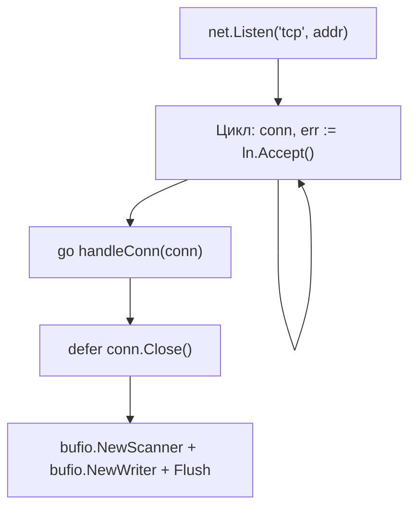

*Как поднять многопользовательский TCP-сервер на стандартном пакете `net`, обслуживать каждое соединение в отдельной горутине, ставить дедлайны и тестировать всё без конфликта портов на `"127.0.0.1:0"`.*

> «Новым типам проще удовлетворять маленьким интерфейсам. Хорошее практическое правило проектирования интерфейсов: требуйте только то, что вам действительно нужно.» — Алан Донован и Брайан Керниган

Теория TCP остаётся абстракцией, пока вы сами не откроете сокет, не примете живое соединение и не обменяетесь строками с клиентом. В Go для этого не нужны внешние библиотеки: стандартный пакет **`net`** прячет системные вызовы `socket`, `bind`, `listen` и `accept` за тремя понятными интерфейсами, а каждое TCP-соединение `net.Conn` реализует знакомые нам `io.Reader`, `io.Writer` и `io.Closer`.

## Анатомия TCP-сервера в Go

Работа любого конкурентного TCP-сервера складывается из пяти коротких шагов:



1. **Открыть слушающий сокет (`net.Listen`).** Вызов `net.Listen("tcp", addr)` просит ядро зарезервировать порт и начать принимать входящие рукопожатия TCP. Если порт уже занят, вернётся ошибка `bind: address already in use`.
2. **Принимать клиентов в цикле (`ln.Accept`).** Метод `Accept()` блокируется, пока очередной клиент не завершит тройное рукопожатие, и возвращает готовое соединение `net.Conn`. Когда мы сами остановим сервер вызовом `ln.Close()`, `Accept()` вернёт ошибку `net.ErrClosed` — это штатный сигнал выйти из цикла.
3. **Запустить горутину на каждое соединение.** Если обрабатывать `conn` прямо внутри цикла `Accept`, второй клиент будет ждать, пока не отключится первый. Запуск `go handleConn(conn)` позволяет серверу спокойно держать тысячи одновременных подключений — стек горутины стартует с 2 КБ.
4. **Всегда закрывать сокет (`defer conn.Close()`).** Каждый `net.Conn` занимает файловый дескриптор ОС. Стоит забыть `Close()`, и через несколько тысяч клиентов сервер упрётся в лимит `ulimit -n`.
5. **Оформить фрейминг и дедлайны.** Поверх потока байтов `conn` вешаем `bufio.NewScanner(conn)` для чтения строк до `\n` и `bufio.NewWriter(conn)` для буферизованной отправки ответов (с обязательным `Flush()`). А перед чтением каждой команды сдвигаем дедлайн через `conn.SetReadDeadline`, чтобы молчащий клиент не держал горутину и дескриптор вечно.

## Пишем TCP-эхо-сервер и тестируем его на `"127.0.0.1:0"`

Одна из лучших привычек при разработке и тестировании сетевого кода в Go — передавать в `net.Listen` порт **`0`**: `"127.0.0.1:0"`. Ядро Linux само выбирает гарантированно свободный эфемерный порт, и тесты никогда не падают из-за конфликта с уже запущенным сервисом. Узнать выданный порт можно сразу после старта через `ln.Addr().String()`.

Соберём полноценный эхо-сервер и подключимся к нему клиентом через `net.Dial` в одной самодостаточной программе:

```go
package main

import (
	"bufio"
	"errors"
	"fmt"
	"net"
	"strings"
	"sync"
	"time"
)

const idleTimeout = 2 * time.Second

func handleConn(conn net.Conn) {
	defer conn.Close()

	scanner := bufio.NewScanner(conn)
	writer := bufio.NewWriter(conn)

	for {
		// Ограничиваем ожидание следующей строки от клиента.
		if err := conn.SetReadDeadline(time.Now().Add(idleTimeout)); err != nil {
			return
		}
		if !scanner.Scan() {
			return
		}
		line := strings.TrimSpace(scanner.Text())
		if line == "QUIT" {
			_, _ = fmt.Fprintln(writer, "BYE")
			_ = writer.Flush()
			return
		}
		if _, err := fmt.Fprintf(writer, "ECHO: %s\n", line); err != nil {
			return
		}
		if err := writer.Flush(); err != nil {
			return
		}
	}
}

func main() {
	ln, err := net.Listen("tcp", "127.0.0.1:0")
	if err != nil {
		panic(err)
	}

	var wg sync.WaitGroup
	wg.Add(1)
	go func() {
		defer wg.Done()
		for {
			conn, err := ln.Accept()
			if err != nil {
				if errors.Is(err, net.ErrClosed) {
					return
				}
				continue
			}
			wg.Add(1)
			go func() {
				defer wg.Done()
				handleConn(conn)
			}()
		}
	}()

	// Клиентская часть: подключаемся к выданному ОС адресу.
	addr := ln.Addr().String()
	conn, err := net.DialTimeout("tcp", addr, time.Second)
	if err != nil {
		panic(err)
	}
	defer conn.Close()
	_ = conn.SetDeadline(time.Now().Add(time.Second))

	reader := bufio.NewReader(conn)
	for _, msg := range []string{"hello tcp", "bookmarkflow", "QUIT"} {
		if _, err := fmt.Fprintln(conn, msg); err != nil {
			panic(err)
		}
		reply, err := reader.ReadString('\n')
		if err != nil {
			panic(err)
		}
		fmt.Printf("Отправлено: %-12s -> Ответ: %s", msg, reply)
	}

	_ = ln.Close()
	wg.Wait()
}
```

Запуск программы даёт чистый воспроизводимый вывод:

```text
Отправлено: hello tcp    -> Ответ: ECHO: hello tcp
Отправлено: bookmarkflow -> Ответ: ECHO: bookmarkflow
Отправлено: QUIT         -> Ответ: BYE
```

Посмотрите на взаимодействие `ln.Close()` и `sync.WaitGroup`: закрытие слушателя мгновенно разблокирует `ln.Accept()` с ошибкой `net.ErrClosed`, цикл приёма завершается, а `wg.Wait()` дожидается, пока все активные обработчики закончат работу и закроют свои сокеты. Именно эту схему мы перенесём в шаг 6 `BookmarkFlow`.

## Подводные камни

**Ловушка 1. Забыть `writer.Flush()` после записи ответа.**  
`bufio.NewWriter(conn)` накапливает данные в буфере на 4 КБ и не отправляет их в сокет, пока буфер не заполнится. Если после `fmt.Fprintln(writer, "PONG")` не вызвать `writer.Flush()`, сервер будет ждать следующую команду от клиента, а клиент — бесконечно ждать ответ `"PONG"`. Классическая взаимная блокировка по сети.

**Ловушка 2. Путать `SetDeadline` на весь сеанс с `SetReadDeadline` на команду.**  
`conn.SetDeadline(t)` задаёт абсолютную точку времени (*wall clock*), а не интервал тишины. Если выставить его один раз при подключении на 2 секунды, даже активно работающий клиент будет оборван ровно через 2 секунды. Для таймаута простоя обновляйте `SetReadDeadline(time.Now().Add(idleTimeout))` перед каждым шагом чтения.

**Ловушка 3. Игнорировать ограничение длины строки в `bufio.Scanner`.**  
По умолчанию `bufio.Scanner` принимает строки длиной до 64 КБ. Если клиент пришлёт строку длиннее без `\n`, `scanner.Scan()` вернёт `false`, а `scanner.Err()` — ошибку `bufio.ErrTooLong`. Для текстового командного протокола это даже полезно: защищает сервер от бесконечной строки, съедающей память.

> [!check] Проверь понимание
> Что произойдёт, если в цикле `Accept()` нашего эхо-сервера убрать ключевое слово `go` перед вызовом `handleConn(conn)`?
>
> Сервер станет однопоточным: пока первый подключившийся клиент держит соединение открытым (не прислал `QUIT` и не истёк таймаут), вызов `Accept()` не выполнится снова, и все остальные клиенты будут стоять в очереди.

## Практика

**Упражнение 1 (Базовое). Диагностика зависшего протокола.**  
Разработчик написал клиент и сервер поверх TCP. Клиент шлёт `"PING\n"` и вызывает `reader.ReadString('\n')`. Сервер читает `"PING"` через `bufio.Scanner`, пишет `fmt.Fprintln(writer, "PONG")` в `bufio.NewWriter(conn)` и переходит к следующей итерации `scanner.Scan()`. Обе программы намертво зависают. Назовите причину и одну строку, которая всё починит.

> [!solution] Показать решение
> Строка `"PONG\n"` осталась в памяти сервера внутри буфера `bufio.NewWriter` (он сбрасывается автоматически только при заполнении 4 КБ). В итоге клиент ждёт ответа, а сервер ждёт новой строки от клиента.  
> Исправление: добавить **`_ = writer.Flush()`** (с проверкой ошибки) сразу после записи ответа.

**Упражнение 2 (Практическое). Сервер команд `UPPER` и `QUIT`.**  
Измените обработчик `handleConn` так, чтобы сервер понимал две команды: `UPPER <текст>` возвращает этот текст в верхнем регистре (`strings.ToUpper`), `QUIT` отвечает `BYE` и закрывает соединение, а на любую другую команду сервер отвечает `ERR unknown command`. Проверьте все три ветки в `main()` через `net.Dial` на `"127.0.0.1:0"`.

> [!solution] Показать решение
> ```go
> package main
>
> import (
> 	"bufio"
> 	"errors"
> 	"fmt"
> 	"net"
> 	"strings"
> 	"sync"
> 	"time"
> )
>
> func handleCommandConn(conn net.Conn) {
> 	defer conn.Close()
> 	scanner := bufio.NewScanner(conn)
> 	writer := bufio.NewWriter(conn)
>
> 	for {
> 		_ = conn.SetReadDeadline(time.Now().Add(2 * time.Second))
> 		if !scanner.Scan() {
> 			return
> 		}
> 		line := strings.TrimSpace(scanner.Text())
> 		switch {
> 		case line == "QUIT":
> 			_, _ = fmt.Fprintln(writer, "BYE")
> 			_ = writer.Flush()
> 			return
> 		case strings.HasPrefix(line, "UPPER "):
> 			text := strings.TrimPrefix(line, "UPPER ")
> 			_, _ = fmt.Fprintln(writer, strings.ToUpper(text))
> 		default:
> 			_, _ = fmt.Fprintln(writer, "ERR unknown command")
> 		}
> 		if err := writer.Flush(); err != nil {
> 			return
> 		}
> 	}
> }
>
> func main() {
> 	ln, err := net.Listen("tcp", "127.0.0.1:0")
> 	if err != nil {
> 		panic(err)
> 	}
> 	var wg sync.WaitGroup
> 	wg.Add(1)
> 	go func() {
> 		defer wg.Done()
> 		for {
> 			c, err := ln.Accept()
> 			if err != nil {
> 				if errors.Is(err, net.ErrClosed) {
> 					return
> 				}
> 				continue
> 			}
> 			wg.Add(1)
> 			go func() {
> 				defer wg.Done()
> 				handleCommandConn(c)
> 			}()
> 		}
> 	}()
>
> 	conn, err := net.Dial("tcp", ln.Addr().String())
> 	if err != nil {
> 		panic(err)
> 	}
> 	defer conn.Close()
> 	r := bufio.NewReader(conn)
>
> 	for _, cmd := range []string{"UPPER go sockets", "HELP", "QUIT"} {
> 		_, _ = fmt.Fprintln(conn, cmd)
> 		resp, err := r.ReadString('\n')
> 		if err != nil {
> 			panic(err)
> 		}
> 		fmt.Printf("%s => %s", cmd, resp)
> 	}
>
> 	_ = ln.Close()
> 	wg.Wait()
> }
> ```
> Командный протокол с разделителем `\n` прост в отладке и идеально ложится на `bufio.Scanner` + `bufio.Writer`.

**Упражнение 3 (Со звёздочкой \*). Проверка конкурентности: 20 клиентов одновременно.**  
Запустите эхо-сервер на `"127.0.0.1:0"` и откройте к нему 20 параллельных TCP-соединений из отдельных горутин. Каждый клиент отправляет 5 пронумерованных строк (`"client-3-msg-2"`), проверяет, что получил обратно ровно `"ECHO: client-3-msg-2"`, и закрывает соединение. Убедитесь, что ни один ответ не перепутался и `wg.Wait()` завершается без ошибок.

> [!solution] Показать решение
> ```go
> package main
>
> import (
> 	"bufio"
> 	"errors"
> 	"fmt"
> 	"net"
> 	"strings"
> 	"sync"
> 	"time"
> )
>
> func serveEcho(conn net.Conn) {
> 	defer conn.Close()
> 	sc := bufio.NewScanner(conn)
> 	w := bufio.NewWriter(conn)
> 	for sc.Scan() {
> 		_, _ = fmt.Fprintf(w, "ECHO: %s\n", sc.Text())
> 		if err := w.Flush(); err != nil {
> 			return
> 		}
> 	}
> }
>
> func main() {
> 	ln, err := net.Listen("tcp", "127.0.0.1:0")
> 	if err != nil {
> 		panic(err)
> 	}
> 	var srvWG sync.WaitGroup
> 	srvWG.Add(1)
> 	go func() {
> 		defer srvWG.Done()
> 		for {
> 			c, err := ln.Accept()
> 			if err != nil {
> 				if errors.Is(err, net.ErrClosed) {
> 					return
> 				}
> 				continue
> 			}
> 			srvWG.Add(1)
> 			go func() {
> 				defer srvWG.Done()
> 				serveEcho(c)
> 			}()
> 		}
> 	}()
>
> 	const clients = 20
> 	var cliWG sync.WaitGroup
> 	for id := range clients {
> 		cliWG.Add(1)
> 		go func() {
> 			defer cliWG.Done()
> 			conn, err := net.DialTimeout("tcp", ln.Addr().String(), time.Second)
> 			if err != nil {
> 				panic(err)
> 			}
> 			defer conn.Close()
> 			r := bufio.NewReader(conn)
> 			for m := range 5 {
> 				msg := fmt.Sprintf("client-%d-msg-%d", id, m)
> 				if _, err := fmt.Fprintln(conn, msg); err != nil {
> 					panic(err)
> 				}
> 				got, err := r.ReadString('\n')
> 				if err != nil {
> 					panic(err)
> 				}
> 				want := "ECHO: " + msg
> 				if strings.TrimSpace(got) != want {
> 					panic(fmt.Sprintf("ожидали %q, получили %q", want, got))
> 				}
> 			}
> 		}()
> 	}
>
> 	cliWG.Wait()
> 	_ = ln.Close()
> 	srvWG.Wait()
> 	fmt.Printf("Успешно: %d клиентов x 5 сообщений\n", clients)
> }
> ```
> У каждого TCP-соединения собственный изолированный поток байтов и собственная горутина с локальными `bufio.Scanner`/`bufio.Writer`, поэтому параллельные клиенты не мешают друг другу.

---

У нас в руках две боевые технологии из этого модуля: атомарное сохранение файлов через `os.CreateTemp` + `Sync` + `os.Rename` и конкурентный TCP-сервер с построчным протоколом. В следующем уроке объединим их в сквозном проекте `BookmarkFlow` (шаг 6) — [[8. Практика BookmarkFlow (шаг 6) — атомарная запись и TCP-протокол опроса]].
