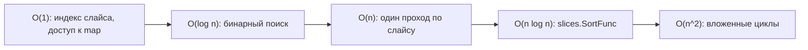

*Как заранее предсказать поведение программы при росте данных в тысячу раз с помощью нотации `Big-O` и почему константы с кэшем CPU всё равно имеют значение.*

> «Цель вычислений — понимание сути, а не числа.»  
> — Ричард Хэмминг *(цит. по Б. Кернигану, «UNIX: A History and a Memoir»)*

В шаге 6 проекта `BookmarkFlow` метод `AtomicStore.Get(id)` ищет закладку циклом по слайсу. На двадцати записях это ~40 наносекунд. Но на 500 000 записях проверка дубликатов URL вложенным циклом превращает мгновенную утилиту в зависший процесс.

Секундомер на ноутбуке измеряет лишь один запуск на одном железе. Инженеру нужно заранее понимать, **как растёт число операций**, когда объём данных $n$ увеличивается в десять, сто или миллион раз.

## Интуиция: считаем не секунды, а кривую роста

Представьте две реализации поиска дубликатов URL среди $n$ закладок. Первая сравнивает каждую пару в двух вложенных циклах — $\frac{n(n - 1)}{2} = \frac{1}{2}n^2 - \frac{1}{2}n$ сравнений. Вторая проходит слайс один раз и запоминает адреса в мапе `seen` — ровно $n$ обращений.

При $n = 10$ разница незаметна: 45 сравнений против 10. При $n = 100\,000$ первый способ делает **5 миллиардов** сравнений, а второй — **100 тысяч** (разрыв в 50 000 раз). Коэффициент $\frac{1}{2}$ и младший член $-\frac{1}{2}n$ теряют значение: ростом управляет $n^2$.

## Нотация `Big-O` после интуиции

Эту скорость роста описывает нотация **`Big-O`** («О большое»): верхняя граница числа операций при росте $n$, без постоянных множителей и младших слагаемых ($3n + 12 \to O(n)$, $\frac{1}{2}n^2 + 100n \to O(n^2)$, чтение `items[i]` $\to O(1)$).

Аналогично оценивают **сложность по памяти** (*space complexity*) — дополнительную память сверх входных данных. Вложенные циклы тратят $O(1)$, а мапа `seen` — $O(n)$. Инженеры постоянно меняют память на время.

Сравним пять главных классов (условно 10 нс на базовую операцию в памяти — между ~1 нс L1-кэша и ~100 нс RAM из Модуля 5):

| Класс | Название | $n = 10$ | $n = 1\,000$ | $n = 1\,000\,000$ | Ориентир времени при $n = 10^6$ |
|---|---|---:|---:|---:|---|
| $O(1)$ | Константная | 1 | 1 | 1 | ~10 нс |
| $O(\log n)$ | Логарифмическая | ~4 | ~10 | ~20 | ~200 нс |
| $O(n)$ | Линейная | 10 | 1 000 | 1 000 000 | ~10 мс |
| $O(n \log n)$ | Линеарифмическая | ~33 | ~10 000 | ~20 000 000 | ~200 мс |
| $O(n^2)$ | Квадратичная | 100 | 1 000 000 | $10^{12}$ | **~2.7 часа** |



Отдельного упоминания заслуживает **амортизированная сложность**. Из Модуля 3 вы знаете: `append` обычно кладёт элемент за $O(1)$, а при `len == cap` выделяет больший массив и копирует $n$ элементов за $O(n)$. Поскольку ёмкость растёт кратно, редкие переезды «размазываются» по массе дешёвых вставок — в среднем `append` даёт **амортизированное $O(1)$**.

*Упрощение этого уровня:* строгие определения $\Omega$, $\Theta$ и метод потенциалов разбираются в Томе 6 («Алгоритмы и 247 задач LeetCode»). Для прикладного Go хватает пяти классов из таблицы.

## Рабочий код: $O(n^2)$ против $O(n)$ на поиске дубликатов URL

Сравним две функции проверки уникальности ссылок в каталоге закладок:

```go
package main

import (
	"fmt"
	"time"
)

// hasDuplicateQuadratic проверяет дубликаты за O(n^2) по времени и O(1) по памяти.
func hasDuplicateQuadratic(urls []string) bool {
	for i := 0; i < len(urls); i++ {
		for j := i + 1; j < len(urls); j++ {
			if urls[i] == urls[j] {
				return true
			}
		}
	}
	return false
}

// hasDuplicateLinear проверяет дубликаты за O(n) по времени и O(n) по памяти.
func hasDuplicateLinear(urls []string) bool {
	seen := make(map[string]struct{}, len(urls))
	for _, u := range urls {
		if _, exists := seen[u]; exists {
			return true
		}
		seen[u] = struct{}{}
	}
	return false
}

func main() {
	urls := make([]string, 20_000)
	for i := range urls {
		urls[i] = fmt.Sprintf("https://example.org/doc/%d", i)
	}

	t0 := time.Now()
	d1 := hasDuplicateQuadratic(urls)
	durQuad := time.Since(t0)

	t1 := time.Now()
	d2 := hasDuplicateLinear(urls)
	durLin := time.Since(t1)

	fmt.Printf("O(n^2): %v за %v\n", d1, durQuad)
	fmt.Printf("O(n):   %v за %v\n", d2, durLin)
}
```

На 20 000 уникальных ссылках (худший случай без дубликатов) терминал показывает показательный разрыв:

```text
$ go run main.go
O(n^2): false за 240.3ms
O(n):   false за 519.2µs
```

Разрыв уже превышает **450 раз**. Увеличьте список в 5 раз (до 100 000 ссылок): линейный вариант вырастет в ~5 раз (~2.6 мс), а квадратичный — в $5^2 = 25$ раз (около 6 секунд).

В `hasDuplicateLinear` важны две детали: `struct{}` занимает **0 байт**, а `make(..., len(urls))` заранее выделяет бакеты без лишних расширений.

## Подводные камни

**Ловушка 1. Скрытый цикл внутри библиотечного вызова.**  
`slices.Contains(seen, u)` внутри цикла по `urls` сканирует `seen` на каждой итерации и незаметно превращает один цикл в $O(n^2)$. Всегда проверяйте сложность вызываемой функции.

**Ловушка 2. Слепая вера в `Big-O` на крошечных объёмах.**  
`Big-O` прячет постоянные множители. Для 8 тегов линейный проход по слайсу в одной кэш-линии L1 (~5 нс) быстрее, чем хеш и обращение к мапе (~20–30 нс). Нотация предсказывает масштабирование, а на малых $n$ решают кэш и простота.

> [!check] Проверь понимание
> Функция сначала сортирует слайс из $n$ закладок за $O(n \log n)$, а затем трижды проходит по нему целиком в отдельных циклах $O(n)$. Какова итоговая сложность функции?
>
> Итоговая сложность — **$O(n \log n)$**. В сумме $O(n \log n) + 3 \cdot O(n)$ отбрасываются константы и младшие слагаемые, потому что при больших $n$ член $n \log n$ растёт быстрее $n$.

## Практика

**Упражнение 1 (Базовое). Оцените сложность фрагментов.**  
Определите сложность по времени и дополнительной памяти для двух функций (размер входного слайса — $n$):
```go
// A:
func firstAndLast(xs []int) (int, int) {
	return xs[0], xs[len(xs)-1]
}

// B:
func countPairsWithSum(xs []int, target int) int {
	count := 0
	for i := range xs {
		for j := i + 1; j < len(xs); j++ {
			if xs[i]+xs[j] == target {
				count++
			}
		}
	}
	return count
}
```

> [!solution] Показать решение
> - **`firstAndLast`:** время $O(1)$, память $O(1)$. Чтение по индексу и `len(xs)` не зависят от длины слайса.
> - **`countPairsWithSum`:** время $O(n^2)$, память $O(1)$. Выполняется $\frac{n(n-1)}{2}$ итераций, а из дополнительной памяти выделяются только три целочисленных счётчика.

**Упражнение 2 (Практическое). Ускорьте подсчёт пар до $O(n)$.**  
Перепишите `countPairsWithSum(xs []int, target int) int` так, чтобы функция работала за $O(n)$ по времени (допускается $O(n)$ дополнительной памяти). Учтите, что в `xs` могут быть повторяющиеся числа: для `xs = []int{2, 2, 2}` и `target = 4` ответ равен `3`.

> [!solution] Показать решение
> Идём по слайсу один раз и храним в мапе `freq`, сколько раз каждое число уже встретилось раньше. Для очередного `x` число новых пар равно `freq[target-x]`:
> ```go
> func countPairsFast(xs []int, target int) int {
> 	freq := make(map[int]int, len(xs))
> 	count := 0
> 	for _, x := range xs {
> 		count += freq[target-x]
> 		freq[x]++
> 	}
> 	return count
> }
> ```
> Для `[2, 2, 2]` на шагах `0, 1, 2` к `count` прибавляется `0 + 1 + 2 = 3`. Каждая пара $(i, j)$ с $i < j$ учитывается ровно один раз, а общая сложность падает с $O(n^2)$ до $O(n)$.

**Упражнение 3 (Со звёздочкой \*). Скрытая квадратичность в конкатенации строк.**  
Почему цикл ниже работает за $O(n^2)$ по времени, а не за $O(n)$, и как исправить его до $O(n)$ с помощью стандартной библиотеки Go?
```go
func joinTags(tags []string) string {
	out := ""
	for _, t := range tags {
		out += t + ","
	}
	return out
}
```

> [!solution] Показать решение
> Строки в Go неизменяемы. На $k$-м шаге операция `out += t + ","` выделяет новую строку и копирует в неё все уже накопленные байты. Суммарное число скопированных элементов растёт как $1 + 2 + \dots + n = \frac{n(n+1)}{2}$, то есть $O(n^2)$.
>
> Исправление за $O(n)$ — использовать `strings.Builder` (или `strings.Join`):
> ```go
> func joinTagsFast(tags []string) string {
> 	var b strings.Builder
> 	for _, t := range tags {
> 		b.WriteString(t)
> 		b.WriteByte(',')
> 	}
> 	return b.String()
> }
> ```
> Внутренний байтовый слайс `strings.Builder` расширяется кратно, обеспечивая амортизированное $O(1)$ на добавление байта и $O(n)$ на весь цикл.

---

Мы научились оценивать рост времени и памяти программы до того, как она попадёт под реальную нагрузку. Теперь применим этот инструмент к двум фундаментальным способам разложить элементы в памяти — непрерывному слайсу и цепочке узлов: [[2. Массивы, слайсы и связные списки — компромиссы вставки и поиска]].
