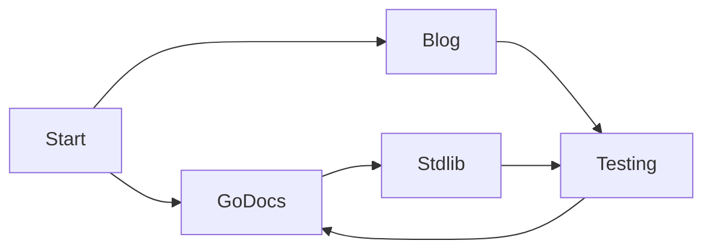

*Как представлять сети ссылок и зависимостей в Go через списки смежности, чем отличаются обходы `BFS` и `DFS` и почему без множества `visited` программа зависнет.*

В `BookmarkFlow` вы решили добавить новую аналитику: сохранять не только саму страницу, но и ссылки, которые ведут с неё на другие сохранённые закладки. Быстро выясняется неудобная вещь: статья `"GoDocs"` ссылается на `"Stdlib"`, `"Stdlib"` — на `"Testing"`, а `"Testing"` ссылается обратно на `"GoDocs"`. Вдобавок на `"Testing"` ведёт ещё и ссылка из `"Blog"`.

В дереве такое невозможно — там у каждого узла ровно один родитель и никаких циклов. Зато такие переплетённые связи встречаются в инженерии повсюду: ссылки между веб-страницами, зависимости пакетов в `go.mod`, маршруты в сети, социальные связи и очереди задач. Математическая модель для них одна — **граф** (*graph*).

## Вершины, рёбра и списки смежности

**Граф** состоит из **вершин** (*vertices*, $V$) — самих объектов — и **рёбер** (*edges*, $E$) — связей между ними. Если связь имеет направление («страница A ссылается на B, но не обязательно наоборот»), граф называют **ориентированным** (*directed*). Если связь взаимна («два города соединены двусторонней дорогой»), граф **неориентированный** (*undirected*).

Посмотрим на небольшой ориентированный граф ссылок между страницами документации (обратите внимание на цикл `GoDocs -> Stdlib -> Testing -> GoDocs`):



Как хранить такой граф в памяти Go? Самый практичный способ для реальных задач — **список смежности** (*adjacency list*): мапа, где ключом служит имя вершины, а значением — слайс её непосредственных соседей:

```go
graph := map[string][]string{
    "Start":   {"GoDocs", "Blog"},
    "GoDocs":  {"Stdlib"},
    "Blog":    {"Testing"},
    "Stdlib":  {"Testing"},
    "Testing": {"GoDocs"},
}
```

Почему список смежности, а не таблица `bool[V][V]` (*матрица смежности*)? На 100 000 страниц со средним числом ссылок 10 матрица займёт ~10 ГБ RAM, почти полностью забитых нулями. Список смежности хранит только реальные связи за **$O(V + E)$** памяти.

## Два базовых обхода: `BFS` против `DFS`

Оба обхода посещают каждую вершину и ребро не больше раза — линейное время **$O(V + E)$**:

1. **Поиск в ширину (`BFS`, *Breadth-First Search*)** опирается на **очередь (FIFO)** из Урока 3 и идёт от старта волнами (1 шаг, 2 шага и т. д.). Первая волна, дошедшая до цели, даёт **кратчайший путь** по числу переходов (`Start -> Blog -> Testing` за 2 шага вместо 3 через `GoDocs`).
2. **Поиск в глубину (`DFS`, *Depth-First Search*)** использует **рекурсию** или явный **стек LIFO**, ныряя по ветке до тупика. Кратчайший путь он не обещает, зато удобен для проверки достижимости и поиска циклов (так компилятор Go ловит циклический `import`).

Обоим алгоритмам необходимо множество **`visited := make(map[string]bool)`** — иначе на первом же цикле обход зациклится навечно.

## Рабочий код: кратчайший путь (`BFS`) и проверка достижимости (`DFS`)

Реализуем оба обхода на нашем графе ссылок:

```go
package main

import (
	"fmt"
	"slices"
)

// ShortestPathBFS находит кратчайший путь от start до goal за O(V + E).
func ShortestPathBFS(graph map[string][]string, start, goal string) ([]string, bool) {
	if start == goal {
		return []string{start}, true
	}
	visited := map[string]bool{start: true}
	parent := make(map[string]string)
	queue := []string{start}

	for head := 0; head < len(queue); head++ {
		cur := queue[head]
		for _, next := range graph[cur] {
			if visited[next] {
				continue
			}
			visited[next] = true
			parent[next] = cur
			if next == goal {
				return reconstructPath(parent, start, goal), true
			}
			queue = append(queue, next)
		}
	}
	return nil, false
}

func reconstructPath(parent map[string]string, start, goal string) []string {
	var path []string
	for cur := goal; cur != start; cur = parent[cur] {
		path = append(path, cur)
	}
	path = append(path, start)
	slices.Reverse(path)
	return path
}

// ReachableDFS возвращает все вершины, достижимые из start, за O(V + E).
func ReachableDFS(graph map[string][]string, start string) []string {
	visited := make(map[string]bool)
	var order []string
	var dfs func(v string)
	dfs = func(v string) {
		visited[v] = true
		order = append(order, v)
		for _, next := range graph[v] {
			if !visited[next] {
				dfs(next)
			}
		}
	}
	dfs(start)
	return order
}

func main() {
	graph := map[string][]string{
		"Start":   {"GoDocs", "Blog"},
		"GoDocs":  {"Stdlib"},
		"Blog":    {"Testing"},
		"Stdlib":  {"Testing"},
		"Testing": {"GoDocs"},
	}

	path, ok := ShortestPathBFS(graph, "Start", "Testing")
	fmt.Printf("BFS Start -> Testing: %v (found=%v)\n", path, ok)
	fmt.Println("DFS from Start:", ReachableDFS(graph, "Start"))
}
```

Вывод терминала:

```text
$ go run main.go
BFS Start -> Testing: [Start Blog Testing] (found=true)
DFS from Start: [Start GoDocs Stdlib Testing Blog]
```

`DFS` провалился по первой ветке `Start -> GoDocs -> Stdlib -> Testing`, а `BFS` обошёл соседей по слоям и нашёл кратчайший путь `[Start Blog Testing]`. Индекс `head` шагает по `queue` без утекающего `queue = queue[1:]`, а `slices.Reverse` разворачивает восстановленную цепочку `parent`.

*Куда расти дальше:* взвешенные графы (Дейкстра) и топологическая сортировка разбираются в **Томе 6 («Алгоритмы и 247 задач LeetCode»)**.

## Подводные камни

**Ловушка 1. Пометка `visited` при извлечении вместо добавления.**  
Если ставить `visited` при выемке из очереди, а не при `append`, одна вершина попадёт в очередь многократно и сломает $O(V + E)$. Помечайте соседа посещённым **в момент добавления в очередь**.

**Ловушка 2. Ожидание кратчайшего пути от `DFS`.**  
`DFS` находит *какой-нибудь* путь, а не самый короткий. Для минимума переходов нужен `BFS`, а для взвешенных рёбер — алгоритм Дейкстры из Тома 6.

> [!check] Проверь понимание
> Сколько раз выполнится внутренний цикл `for _, next := range graph[cur]` в сумме за весь вызов `ShortestPathBFS` на ориентированном графе из $V$ вершин и $E$ рёбер?
>
> Не более **$E$ раз** (по одному разу на каждое исходящее ребро из достижимых вершин), потому что каждая вершина попадает в очередь максимум один раз благодаря `visited`. Вместе с обработкой вершин это и даёт $O(V + E)$.

## Практика

**Упражнение 1 (Базовое). Проследи волну `BFS`.**  
В графе из `main()` мы запускаем `BFS` от вершины `"GoDocs"`. Какие вершины достижимы из `"GoDocs"`, а какие останутся непосещёнными и почему?

> [!solution] Показать решение
> Достижимы **`GoDocs`, `Stdlib`, `Testing`**. Вершины **`Start`** и **`Blog`** останутся непосещёнными, потому что граф ориентированный: рёбра ведут *из* `Start` и `Blog`, но ни одно ребро не ведёт обратно *в* них.

**Упражнение 2 (Практическое). Расстояние в шагах `DistancesBFS`.**  
Напишите функцию `func DistancesBFS(graph map[string][]string, start string) map[string]int`, которая возвращает мапу «вершина → минимальное число переходов от `start`» для всех достижимых вершин (`dist[start] == 0`).

> [!solution] Показать решение
> Сама мапа `dist` одновременно играет роль множества `visited` (через проверку `comma ok`):
> ```go
> func DistancesBFS(graph map[string][]string, start string) map[string]int {
> 	dist := map[string]int{start: 0}
> 	queue := []string{start}
> 	for head := 0; head < len(queue); head++ {
> 		cur := queue[head]
> 		for _, next := range graph[cur] {
> 			if _, seen := dist[next]; !seen {
> 				dist[next] = dist[cur] + 1
> 				queue = append(queue, next)
> 			}
> 		}
> 	}
> 	return dist
> }
> ```
> Для нашего графа от `"Start"` мапа будет содержать `Start:0, GoDocs:1, Blog:1, Stdlib:2, Testing:2`.

**Упражнение 3 (Со звёздочкой \*). Обнаружение циклов в ориентированном графе (`HasCycle`).**  
Простого `visited[v] == true` недостаточно, чтобы отличить настоящий цикл (`A -> B -> A`) от обычного ромба без циклов (`Start -> GoDocs -> Testing` и `Start -> Blog -> Testing` — в `Testing` ведут две ветки, но цикла нет). Как с помощью трёх состояний вершины (`0` — не посещена, `1` — сейчас в текущем пути стека, `2` — полностью обработана) написать `func HasCycle(graph map[string][]string) bool`?

> [!solution] Показать решение
> Цикл есть тогда и только тогда, когда `DFS` встречает соседа в состоянии **`1`** (он прямо сейчас находится в активной цепочке вызовов на стеке):
> ```go
> func HasCycle(graph map[string][]string) bool {
> 	state := make(map[string]int, len(graph)) // 0=new, 1=visiting, 2=done
> 	var dfs func(v string) bool
> 	dfs = func(v string) bool {
> 		state[v] = 1
> 		for _, next := range graph[v] {
> 			if state[next] == 1 {
> 				return true // нашли обратное ребро в текущий путь -> цикл
> 			}
> 			if state[next] == 0 && dfs(next) {
> 				return true
> 			}
> 		}
> 		state[v] = 2
> 		return false
> 	}
> 	for v := range graph {
> 		if state[v] == 0 && dfs(v) {
> 			return true
> 		}
> 	}
> 	return false
> }
> ```
> Внешний цикл `for v := range graph` гарантирует, что проверка поймает цикл даже в несвязной компоненте графа. Сложность — $O(V + E)$.

---

Мы прошли весь базовый арсенал алгоритмов и структур данных: `Big-O`, слайсы и списки, стек с кольцевым буфером, хеш-таблицы, бинарный поиск, сортировку, рекурсию, деревья и графы. Пришло время собрать эти инструменты в реальном коде нашего сквозного проекта — переходим к шагу 7 `BookmarkFlow`: [[11. Практика BookmarkFlow (шаг 7) — индексирование закладок по тегам и быстрый поиск]].
