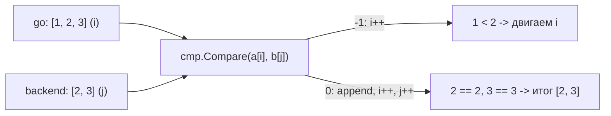

*Собираем шаг 7 проекта `BookmarkFlow` в `project/step07/`: строим инвертированный индекс тегов `TagIndex` с пересечением за $O(k_1 + k_2)$, бинарный поиск по `ID` и сортировку каталога.*

В конце Модуля 5 проявилось узкое место `BookmarkFlow`: `AtomicStore.Get(id)` перебирал все закладки за $O(n)$, а поиск по тегам `go` и `backend` требовал полного сканирования каталога.

В **`project/step07/`** мы соединяем четыре инструмента Модуля 6 — хеш-таблицу, бинарный поиск, метод двух указателей и `slices.SortFunc` — чтобы поиск не деградировал при росте базы.

## Инвертированный индекс `TagIndex` (`index.go`)

Вместо того чтобы при каждом поиске бегать по всем закладкам и спрашивать «есть ли у тебя тег `go`?», перевернём структуру: заведём хеш-таблицу **`byTag map[string][]int`**, где ключ — нормализованный тег в нижнем регистре, а значение — **отсортированный по возрастанию слайс `ID`** всех закладок с этим тегом. Такой словарь называют **инвертированным индексом** (*inverted index*) — именно по этому принципу работают поисковые движки.

Посмотрим, как `Index` и `Remove` поддерживают отсортированность и уникальность каждого списка `ID` с помощью `slices.BinarySearch`, `slices.Insert` и `slices.Delete`:

```go
type TagIndex struct {
	byTag map[string][]int
}

func NewTagIndex() *TagIndex {
	return &TagIndex{byTag: make(map[string][]int)}
}

// Index индексирует все теги закладки.
func (idx *TagIndex) Index(b Bookmark) {
	for _, raw := range b.Tags {
		tag := strings.ToLower(strings.TrimSpace(raw))
		if tag == "" {
			continue
		}
		ids := idx.byTag[tag]
		pos, found := slices.BinarySearch(ids, b.ID)
		if !found {
			idx.byTag[tag] = slices.Insert(ids, pos, b.ID)
		}
	}
}

// Remove удаляет закладку из индекса по её ID и тегам.
func (idx *TagIndex) Remove(id int, tags []string) {
	for _, raw := range tags {
		tag := strings.ToLower(strings.TrimSpace(raw))
		ids := idx.byTag[tag]
		pos, found := slices.BinarySearch(ids, id)
		if !found {
			continue
		}
		ids = slices.Delete(ids, pos, pos+1)
		if len(ids) == 0 {
			delete(idx.byTag, tag)
		} else {
			idx.byTag[tag] = ids
		}
	}
}
```

Разберём два тонких инженерных решения в этом коде:
1. Проверка `if !found` перед `slices.Insert` гарантирует идемпотентность: повторный вызов `Index(b)` с той же закладкой (или дублирующийся тег `["go", "Go"]`) не создаст повторов в списке `ID`.
2. При удалении последнего `ID` у тега мы вызываем `delete(idx.byTag, tag)`, чтобы не копить в мапе пустые ключи.

## Пересечение тегов методом двух указателей за $O(k_1 + k_2)$

`FindByTag(tag)` забирает список из мапы за $O(1)$ и отдаёт защитную копию `slices.Clone`. А чтобы найти закладки, у которых есть **все** указанные теги (`FindByAllTags("go", "backend")`), не нужен вложенный цикл $O(k_1 \cdot k_2)$: списки в `byTag` уже отсортированы. Два индекса `i` и `j` идут слева направо, сдвигая меньший элемент, а при равенстве пишут `ID` в ответ и двигают оба:



Вот реализация из `project/step07/index.go`:

```go
func (idx *TagIndex) FindByTag(tag string) []int {
	key := strings.ToLower(strings.TrimSpace(tag))
	return slices.Clone(idx.byTag[key])
}

func (idx *TagIndex) FindByAllTags(tags ...string) []int {
	if len(tags) == 0 {
		return nil
	}
	res := idx.FindByTag(tags[0])
	for _, raw := range tags[1:] {
		res = intersectSorted(res, idx.FindByTag(raw))
		if len(res) == 0 {
			return nil
		}
	}
	return res
}

func intersectSorted(a, b []int) []int {
	var out []int
	i, j := 0, 0
	for i < len(a) && j < len(b) {
		switch cmp.Compare(a[i], b[j]) {
		case -1:
			i++
		case 1:
			j++
		case 0:
			out = append(out, a[i])
			i++
			j++
		}
	}
	return out
}
```

На каждой итерации `for` минимум один из индексов `i` или `j` увеличивается на 1, поэтому цикл делает не больше `len(a) + len(b)` шагов — строгое **$O(k_1 + k_2)$**. А ранний выход `if len(res) == 0 { return nil }` мгновенно обрывает цепочку, если пересечение уже опустело.

## Бинарный поиск по `ID` и сортировка по названию

Завершают шаг 7 две чистые функции из Уроков 5 и 6 — поиск в отсортированном по `ID` каталоге за $O(\log n)$ и неизменяющая сортировка по названию за $O(n \log n)$:

```go
// BinarySearchByID ищет закладку по ID в слайсе, отсортированном по возрастанию ID, за O(log n).
func BinarySearchByID(sorted []Bookmark, id int) (Bookmark, bool) {
	lo, hi := 0, len(sorted)-1
	for lo <= hi {
		mid := lo + (hi-lo)/2
		switch cmp.Compare(sorted[mid].ID, id) {
		case 0:
			return sorted[mid], true
		case -1:
			lo = mid + 1
		case 1:
			hi = mid - 1
		}
	}
	return Bookmark{}, false
}

// SortByTitle возвращает новую копию слайса, отсортированную по названию (без учёта регистра) и ID.
func SortByTitle(items []Bookmark) []Bookmark {
	out := slices.Clone(items)
	slices.SortFunc(out, func(a, b Bookmark) int {
		if c := cmp.Compare(strings.ToLower(a.Title), strings.ToLower(b.Title)); c != 0 {
			return c
		}
		return cmp.Compare(a.ID, b.ID)
	})
	return out
}
```

`SortByTitle` не портит порядок исходного слайса (сначала делает `slices.Clone(items)`), а при совпадении названий гарантирует детерминированный порядок по `ID`.

## Проверка тестами (`index_test.go`)

В `project/step07/index_test.go` лежат тесты `TestTagIndexAndIntersection` (индексация с разным регистром, пересечение тегов, `Remove`) и `TestBinarySearchByIDAndSortByTitle` (бинарный поиск и сортировка `SortByTitle`). Прогон с `-race` из каталога `project/`:

```text
$ go test -count=1 -race -v ./step07
=== RUN   TestTagIndexAndIntersection
--- PASS: TestTagIndexAndIntersection (0.00s)
=== RUN   TestBinarySearchByIDAndSortByTitle
--- PASS: TestBinarySearchByIDAndSortByTitle (0.00s)
PASS
ok  	github.com/UnrealTemplier/go-textbook-v2-vol1/project/step07	1.009s
```

## Подводные камни

**Ловушка 1. Возврат внутреннего слайса без `slices.Clone`.**  
Если вернуть `idx.byTag[key]` напрямую, внешний код может сделать `slices.Reverse(ids)` и незаметно сломать отсортированность индекса — после этого `BinarySearch` и `intersectSorted` начнут терять записи.

**Ловушка 2. Разная нормализация при записи и удалении.**  
Если в `Index` есть `strings.TrimSpace`, а в `Remove` его забыли, ключ `" go "` не найдётся и удалённая закладка останется «призраком» в выдаче. Выносите нормализацию в одну функцию `normalizeTag`.

> [!check] Проверь понимание
> В `TestTagIndexAndIntersection` закладки индексируются в порядке `ID = 3, 1, 2`. Почему `idx.FindByTag("go")` возвращает `[1, 2, 3]`?
>
> `Index` находит точку вставки через `slices.BinarySearch` и вставляет `ID` через `slices.Insert`, поддерживая строгую сортировку после каждой вставки.

## Практика

**Упражнение 1 (Базовое). Оценка сложности операций `TagIndex`.**  
Пусть тег `"go"` стоит у $k$ закладок. Какова временная сложность: (а) `FindByTag("go")`, (б) `Index(b)` при вставке `ID` в начало списка тега `"go"`, (в) `FindByAllTags("go", "http")`, если у `"http"` $m$ закладок?

> [!solution] Показать решение
> - (а) **$O(k)$** из-за `slices.Clone` (доступ в мапе — $O(1)$).
> - (б) **$O(k)$**: `BinarySearch` находит позицию `0` за $O(\log k)$, но `slices.Insert` сдвигает $k$ элементов (при монотонно растущих `ID` вставка в конец работает за амортизированное $O(1)$).
> - (в) **$O(k + m)$**: `intersectSorted` проходит оба отсортированных слайса за один проход.

**Упражнение 2 (Практическое). Поиск по любому из тегов (`FindByAnyTag`).**  
Напишите метод `func (idx *TagIndex) FindByAnyTag(tags ...string) []int`, возвращающий отсортированный список уникальных `ID` закладок с **хотя бы одним** из тегов.

> [!solution] Показать решение
> Объединяем два отсортированных слайса без дубликатов методом двух указателей за $O(k_1 + k_2)$:
> ```go
> func unionSorted(a, b []int) []int {
> 	out := make([]int, 0, len(a)+len(b))
> 	i, j := 0, 0
> 	for i < len(a) && j < len(b) {
> 		switch cmp.Compare(a[i], b[j]) {
> 		case -1:
> 			out = append(out, a[i])
> 			i++
> 		case 1:
> 			out = append(out, b[j])
> 			j++
> 		case 0:
> 			out = append(out, a[i])
> 			i++
> 			j++
> 		}
> 	}
> 	out = append(out, a[i:]...)
> 	out = append(out, b[j:]...)
> 	return out
> }
>
> func (idx *TagIndex) FindByAnyTag(tags ...string) []int {
> 	var res []int
> 	for _, raw := range tags {
> 		res = unionSorted(res, idx.FindByTag(raw))
> 	}
> 	return res
> }
> ```
> В `case 0` равный `ID` пишется ровно один раз, поэтому результат сразу отсортирован и уникален.

**Упражнение 3 (Со звёздочкой \*). Ускорение `FindByAllTags` на перекошенных тегах.**  
У тега `"go"` 500 000 закладок, а у редкого тега `"wasm"` — 12. При `FindByAllTags("go", "wasm")` текущая версия скопирует 500 000 `ID` и обойдёт 500 012 элементов. Как ускорить пересечение, не меняя структуру `byTag`?

> [!solution] Показать решение
> Два взаимодополняющих улучшения:
> 1. **Начинать с самого короткого списка:** отсортировать теги по возрастанию `len(idx.byTag[key])` (редкий `"wasm"` идёт первым; при длине `0` сразу возвращаем `nil`).
> 2. **Пересекать бинарным поиском при перекосе ($k_1 \ll k_2$):** для каждого из 12 `ID` тега `"wasm"` вызвать `slices.BinarySearch` в 500-тысячном списке `"go"` — около $12 \times 19 \approx 228$ сравнений ($O(k_1 \log k_2)$) вместо $500\,012$ шагов.

---

Мы завершаем Модуль 6. У вас в руках полная инженерная база Тома 1: Go, стандартная библиотека, конкурентность, устройство памяти, Linux и сетей, плюс трезвый расчёт сложности и структур данных. В финальном **Модуле 7 («Первый реальный HTTP-бэкенд на Go»)** мы превратим `BookmarkFlow` в полноценный веб-сервис на стандартной библиотеке Go с JSON API, тестами обработчиков и упаковкой в контейнер.
