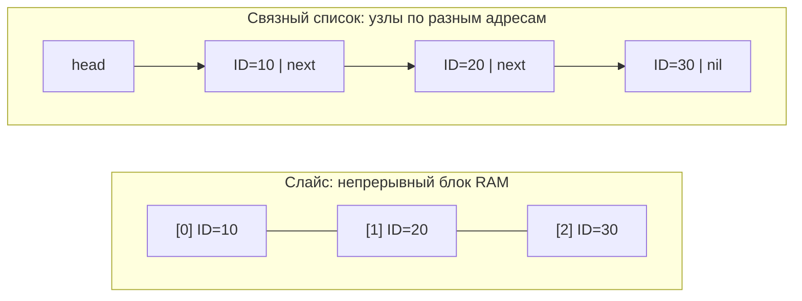

*Сравниваем непрерывное хранение в слайсах с цепочкой узлов связного списка и разбираемся, почему современный процессор почти всегда голосует за слайс.*

Допустим, в `BookmarkFlow` вы хотите вставлять новые закладки строго в начало списка, чтобы самые свежие всегда шли первыми. Если хранить записи в слайсе, вставка по индексу `0` заставит сдвинуть вправо каждый существующий элемент — $O(n)$ операций копирования при каждом добавлении.

Логичный вопрос: нельзя ли хранить элементы так, чтобы вставлять запись в начало без единого сдвига? Именно эту задачу решает **связный список** (*linked list*). Но у его гибкости есть скрытая цена, которую отлично видно, если вспомнить про кэш-линии процессора из Модуля 5.

## Две раскладки данных в оперативной памяти

В **массиве и слайсе** все элементы лежат в одном непрерывном участке RAM друг за другом. Чтобы добраться до `items[k]`, процессор не перебирает предыдущие ячейки — он вычисляет адрес одной формулой `base + k * sizeOfElement` за $O(1)$.

В **связном списке** элементы разбросаны по разным адресам в куче. Каждый элемент завёрнут в узел (*node*), который хранит само значение и указатель `next` на следующий узел. Снаружи программа держит только указатель на первый узел — голову (`head`):



Если в каждом узле есть только указатель вперёд (`next`), список называют **односвязным** (*singly linked list*). Если добавить ещё и указатель назад (`prev`), получится **двусвязный список** (*doubly linked list*): по нему можно шагать в обе стороны и удалять узел за $O(1)$, если у вас уже есть указатель прямо на него.

## Таблица компромиссов и поправка на кэш CPU

Сведём асимптотику операций для слайса и односвязного списка (считаем, что список хранит `head`, а слайс расширяется через `append`):

| Операция | Слайс `[]T` | Односвязный список |
|---|---|---|
| Доступ по индексу `i` | **$O(1)$** | $O(n)$ — шагать от `head` |
| Поиск по значению | $O(n)$ | $O(n)$ |
| Добавление в начало | $O(n)$ — сдвиг всех элементов | **$O(1)$** — поменять `head` |
| Добавление в конец | **$O(1)$** амортизированно | $O(1)$ с полем `tail` (иначе $O(n)$) |
| Удаление известного узла | $O(n)$ — сдвиг хвоста | $O(1)$ в двусвязном списке |
| Память на элемент | `sizeof(T)` | `sizeof(T) + 8` байт на каждый указатель |

На бумаге таблица выглядит как честная ничья. В реальном железе перевес почти всегда на стороне слайса.

Вспомните Модуль 5: процессор читает память **кэш-линиями по 64 байта**. Когда вы идёте циклом по `[]int64`, одно обращение к RAM подгружает сразу 8 соседних чисел, а аппаратный префетчер заранее приносит следующие линии. В связном списке каждый переход `cur = cur.next` прыгает по случайному адресу в куче (*pointer chasing*), ломает локальность данных и рискует промахнуться мимо кэша на ~100 нс. Кроме того, каждый узел — отдельная аллокация, за которой приходится следить сборщику мусора.

Поэтому в стандартной библиотеке Go пакет `container/list` (двусвязный список на `any`) используют редко — в основном там, где действительно нужно удалять и переносить элементы из середины за строгое $O(1)$ (например, в кэше вытеснения LRU, который вы разберёте в Томе 6). В 95% прикладных задач слайс оказывается и проще, и быстрее.

## Рабочий код: односвязный список закладок в Go

Напишем компактный односвязный список с операциями вставки в начало за $O(1)$, поиска и удаления по `ID`:

```go
package main

import "fmt"

type BookmarkNode struct {
	ID    int
	Title string
	next  *BookmarkNode
}

type BookmarkList struct {
	head *BookmarkNode
}

// PushFront добавляет закладку в начало списка за O(1).
func (l *BookmarkList) PushFront(id int, title string) {
	l.head = &BookmarkNode{ID: id, Title: title, next: l.head}
}

// RemoveByID удаляет первый узел с указанным ID за O(n).
func (l *BookmarkList) RemoveByID(id int) bool {
	if l.head == nil {
		return false
	}
	if l.head.ID == id {
		l.head = l.head.next
		return true
	}
	prev := l.head
	for cur := l.head.next; cur != nil; cur = cur.next {
		if cur.ID == id {
			prev.next = cur.next
			return true
		}
		prev = cur
	}
	return false
}

func main() {
	var list BookmarkList
	list.PushFront(1, "Go Spec")
	list.PushFront(2, "Testing")
	list.PushFront(3, "Slices")

	list.RemoveByID(2)
	for cur := list.head; cur != nil; cur = cur.next {
		fmt.Printf("%d:%s ", cur.ID, cur.Title)
	}
	fmt.Println()
}
```

Запуск выводит оставшиеся узлы в порядке от головы к хвосту:

```text
$ go run main.go
3:Slices 1:Go Spec
```

Посмотрите на `PushFront`: всего одна строка создаёт новый узел, направляет его `next` на прежнюю голову и обновляет `l.head`. Ни один старый узел при этом не сдвигается и не копируется. А в `RemoveByID` нам приходится тащить дополнительный указатель `prev`, чтобы при удалении `cur` «перекинуть мост» `prev.next = cur.next`.

## Подводные камни

**Ловушка 1. Потеря хвоста списка при неправильном порядке присваиваний.**  
Если при вставке нового узла после `prev` сначала написать `prev.next = node`, а потом `node.next = prev.next`, то `node.next` укажет сам на себя, хвост списка потеряется, а следующий обход уйдёт в бесконечный цикл. Правильный порядок всегда один: сначала привяжите новый узел к хвосту (`node.next = prev.next`), и лишь затем переключите `prev.next = node`.

**Ловушка 2. Паника `nil pointer dereference` на пустом списке или удалении головы.**  
Новички часто забывают проверить `l.head == nil` перед обращением к `l.head.ID` и получают панику во время выполнения. Второе популярное решение — использовать фиктивный узел-страж (`dummy := &BookmarkNode{next: l.head}`), который убирает отдельную ветку `if` для головы.

> [!check] Проверь понимание
> У вас есть слайс из 50 000 структур `Bookmark`, порядок элементов в нём не важен, и нужно удалить элемент по индексу `i` за $O(1)$. Как это сделать без сдвига хвоста и без связного списка?
>
> Записать последний элемент поверх удаляемого и укоротить слайс на 1: `items[i] = items[len(items)-1]; items = items[:len(items)-1]` (при наличии ссылочных полей предварительно обнулив последний слот). Никаких сдвигов — строгое $O(1)$.

## Практика

**Упражнение 1 (Базовое). Проследи указатели (Code Tracing).**  
После выполнения кода ниже какие `ID` напечатает цикл обхода от `list.head`?
```go
var list BookmarkList
list.PushFront(10, "A")
list.PushFront(20, "B")
list.PushFront(30, "C")
list.RemoveByID(30)
list.PushFront(40, "D")
```

> [!solution] Показать решение
> Программа напечатает `40 20 10`.
> После трёх `PushFront` цепочка выглядит как `30 -> 20 -> 10 -> nil`. `RemoveByID(30)` сдвигает `head` на `20`, а `PushFront(40, "D")` ставит узел `40` перед `20`.

**Упражнение 2 (Практическое). Разворот односвязного списка на месте.**  
Напишите метод `func (l *BookmarkList) Reverse()`, который разворачивает порядок узлов в списке за $O(n)$ по времени и $O(1)$ дополнительной памяти (без создания новых узлов и слайсов).

> [!solution] Показать решение
> Держим три указателя: `prev` (уже развёрнутая часть), `cur` (текущий узел) и `next` (сохранённый хвост, чтобы не потерять остаток списка):
> ```go
> func (l *BookmarkList) Reverse() {
> 	var prev *BookmarkNode
> 	cur := l.head
> 	for cur != nil {
> 		next := cur.next
> 		cur.next = prev
> 		prev = cur
> 		cur = next
> 	}
> 	l.head = prev
> }
> ```
> На каждом шаге мы разворачиваем стрелку `cur.next` назад и сдвигаем пару `(prev, cur)` вперёд. В конце `prev` указывает на новую голову списка.

**Упражнение 3 (Со звёздочкой \*). Выбор структуры данных в реальном проекте.**  
Для каждой задачи выберите **слайс** или **двусвязный список** и коротко обоснуйте выбор:
1. Хранить 100 000 записей лога и регулярно пробегать по ним для расчёта статистики.
2. Построить очередь задач с отменой произвольной задачи за $O(1)$, когда на каждую задачу хранится ссылка в мапе `map[TaskID]*Node`.

> [!solution] Показать решение
> 1. **Слайс.** Линейный обход по непрерывному блоку памяти максимально использует 64-байтные кэш-линии CPU и не тратит память на указатели.
> 2. **Двусвязный список.** Поскольку мапа отдаёт прямой указатель `*Node`, двусвязный список позволяет вырезать отменённую задачу из середины очереди за строгое $O(1)$ без сдвига соседних элементов (именно так устроен классический LRU-кэш).

---

Мы увидели, как устроены два базовых контейнера в памяти. Часто программе не нужен доступ к произвольной позиции — ей хватает строгих правил добавления и извлечения только с краёв. Разберём две такие дисциплины и быструю очередь без утечек памяти: [[3. Стек (LIFO), очередь (FIFO) и кольцевой буфер на Go]].
