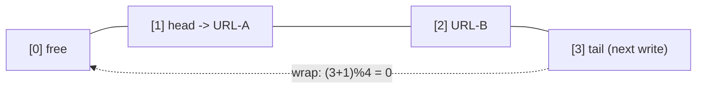

*Разбираем дисциплины LIFO и FIFO, находим коварную утечку памяти в наивной очереди на слайсе и строим быстрый кольцевой буфер на дженериках Go.*

Представьте две новые возможности для `BookmarkFlow`. Первая — команда «Отменить удаление» (`Undo`): пользователь удалил три закладки подряд и нажимает отмену — вернуться должна именно **последняя** удалённая запись. Вторая — фоновая очередь проверки URL: ссылки должны проверяться в том же порядке, в котором пользователь их добавил — **первая** пришедшая ссылка уходит в работу первой.

Обе задачи ограничивают набор операций контейнера до двух действий: «положить» и «забрать». Вместо доступа по произвольному индексу программа опирается на строгий порядок обработки.

## Стек (LIFO) и очередь (FIFO)

**Стек** (*stack*) работает по правилу **LIFO** (*Last In, First Out* — «последним вошёл, первым вышел»). Представьте стопку тарелок: новую кладут наверх (`Push`) и снимают тоже сверху (`Pop`). Аналогия точна только для дисциплины доступа — в памяти стек это обычный слайс, растущий в конец. Вы уже сталкивались со стеком в Go: так выполняется `defer` и так работает стек вызовов функций.

**Очередь** (*queue*) работает по правилу **FIFO** (*First In, First Out* — «первым вошёл, первым вышел»). Новые задачи встают в хвост (`Enqueue`), а забираются из головы (`Dequeue`). В конкурентном Go буферизированный канал `make(chan Task, 64)` по сути и есть потокобезопасная очередь фиксированного размера.

Для стека обычный слайс подходит идеально: `append` в конец стоит амортизированное $O(1)$, а снятие с конца `s = s[:len(s)-1]` — строгое $O(1)$. А вот с очередью на слайсе новички почти всегда наступают на мину:

```go
// ОПАСНЫЙ антипаттерн очереди на слайсе!
item := queue[0]
queue = queue[1:] // указатель ptr ползёт вправо, память в начале массива не освобождается!
```

Каждый сдвиг `queue = queue[1:]` смещает начало слайса вправо и уменьшает `cap`. Освобождённые ячейки слева остаются в старом базовом массиве и удерживают память (а если там указатели или строки — ещё и объекты, на которые они ссылаются), пока `append` наконец не вызовет переаллокацию. Если очередь постоянно держит ~100 элементов, пропуская миллион задач, она бесконечно копирует и перевыделяет массивы.

## Кольцевой буфер (*Ring Buffer*)

Решение элегантно и не требует связных списков: **замкнём фиксированный слайс в кольцо**. Мы храним массив `buf` длины `cap`, индекс чтения `head`, индекс записи `tail` и число элементов `count`.

Когда `head` или `tail` доходят до последнего индекса `len(buf)-1`, следующий шаг переводит их обратно в `0` операцией остатка от деления: `(idx + 1) % len(buf)`.



Все операции — `Enqueue`, `Dequeue` и `Len` — работают за **строгое $O(1)$**, без единой лишней аллокации и с полной локальностью в кэше CPU. Именно по этому принципу устроены внутренние буферы каналов, сетевых сокетов и аудиопотоков.

## Рабочий код: дженерик-стек и кольцевой буфер на Go 1.24

Реализуем обе структуры с типовым параметром `T any` и покажем, как правильно очищать освобождённые слоты для сборщика мусора:

```go
package main

import "fmt"

// Stack реализует дисциплину LIFO поверх слайса.
type Stack[T any] struct {
	items []T
}

func (s *Stack[T]) Push(v T) {
	s.items = append(s.items, v)
}

func (s *Stack[T]) Pop() (T, bool) {
	var zero T
	if len(s.items) == 0 {
		return zero, false
	}
	last := len(s.items) - 1
	v := s.items[last]
	s.items[last] = zero // обнуляем слот, чтобы GC мог освободить ссылки внутри T
	s.items = s.items[:last]
	return v, true
}

// RingQueue реализует очередь FIFO фиксированной ёмкости без лишних аллокаций.
type RingQueue[T any] struct {
	buf   []T
	head  int
	tail  int
	count int
}

func NewRingQueue[T any](capacity int) *RingQueue[T] {
	return &RingQueue[T]{buf: make([]T, capacity)}
}

func (q *RingQueue[T]) Enqueue(v T) bool {
	if q.count == len(q.buf) {
		return false // буфер полон
	}
	q.buf[q.tail] = v
	q.tail = (q.tail + 1) % len(q.buf)
	q.count++
	return true
}

func (q *RingQueue[T]) Dequeue() (T, bool) {
	var zero T
	if q.count == 0 {
		return zero, false
	}
	v := q.buf[q.head]
	q.buf[q.head] = zero
	q.head = (q.head + 1) % len(q.buf)
	q.count--
	return v, true
}

func main() {
	var undo Stack[string]
	undo.Push("https://go.dev")
	undo.Push("https://pkg.go.dev")
	lastDeleted, _ := undo.Pop()
	fmt.Println("Undo:", lastDeleted)

	q := NewRingQueue[string](2)
	fmt.Println("Enqueue A:", q.Enqueue("A"))
	fmt.Println("Enqueue B:", q.Enqueue("B"))
	fmt.Println("Enqueue C:", q.Enqueue("C")) // буфер полон
	first, _ := q.Dequeue()
	fmt.Println("Dequeue:", first)
	fmt.Println("Enqueue C again:", q.Enqueue("C")) // перенос tail в индекс 0
	second, _ := q.Dequeue()
	third, _ := q.Dequeue()
	fmt.Println("Rest:", second, third)
}
```

Вывод терминала подтверждает обе дисциплины и «заворот» индекса `tail` в начало буфера:

```text
$ go run main.go
Undo: https://pkg.go.dev
Enqueue A: true
Enqueue B: true
Enqueue C: false
Dequeue: A
Enqueue C again: true
Rest: B C
```

Обратите внимание на поле `count` в `RingQueue`. Без него состояние `head == tail` двусмысленно: оно возникает и когда буфер полностью пуст, и когда он полностью забит. Счётчик `count` снимает неоднозначность простым условием `q.count == 0` или `q.count == len(q.buf)`.

## Подводные камни

**Ловушка 1. Забытое обнуление ячейки при `Pop` и `Dequeue`.**  
После `s.items = s.items[:last]` сам базовый массив никуда не исчез. Если `T` — указатель, структура с указателями или строка, старый слот `s.items[last]` продолжит ссылаться на объект в куче, и сборщик мусора не сможет его удалить. Запись `var zero T; s.items[last] = zero` разрывает эту ссылку.

**Ловушка 2. Очередь с нулевой ёмкостью.**  
При `NewRingQueue[int](0)` `Enqueue` вернёт `false`, но при неосторожной правке легко получить деление на ноль `% len(q.buf)`. В рабочем коде проверяйте `capacity > 0` при создании.

> [!check] Проверь понимание
> В `RingQueue` ёмкостью 4 элемента `head = 2`, `tail = 1`, `count = 3`. По каким индексам массива `buf` сейчас лежат три активных элемента (в порядке извлечения)?
>
> По индексам **`2`, `3`, `0`**. Первым выйдет `buf[2]`, затем `buf[3]`, затем `(3 + 1) % 4 = 0`, а `tail = 1` указывает на единственную свободную ячейку.

## Практика

**Упражнение 1 (Базовое). Проверка скобок стеком.**  
Напишите функцию `func isBalanced(s string) bool`, которая проверяет корректность расстановки круглых, квадратных и фигурных скобок `()`, `[]`, `{}` с помощью нашего `Stack[rune]`. Прочие символы в строке игнорируются. Примеры: `"map[string](int)"` → `true`, `"([)]"` → `false`.

> [!solution] Показать решение
> Открывающие скобки кладём в стек; встретив закрывающую, снимаем верхнюю и сверяем пару:
> ```go
> func isBalanced(s string) bool {
> 	pairs := map[rune]rune{')': '(', ']': '[', '}': '{'}
> 	var st Stack[rune]
> 	for _, r := range s {
> 		switch r {
> 		case '(', '[', '{':
> 			st.Push(r)
> 		case ')', ']', '}':
> 			top, ok := st.Pop()
> 			if !ok || top != pairs[r] {
> 				return false
> 			}
> 		}
> 	}
> 	_, hasLeftover := st.Pop()
> 	return !hasLeftover
> }
> ```
> Финальная проверка `hasLeftover` ловит незакрытые скобки вроде `"(([]"`. Сложность — $O(n)$ по времени и $O(n)$ по памяти.

**Упражнение 2 (Практическое). Метод `Peek` и `Len` для `RingQueue`.**  
Добавьте к `RingQueue[T]` методы `Len() int` и `Peek() (T, bool)`, который возвращает следующий элемент в очереди, **не удаляя** его.

> [!solution] Показать решение
> ```go
> func (q *RingQueue[T]) Len() int {
> 	return q.count
> }
>
> func (q *RingQueue[T]) Peek() (T, bool) {
> 	var zero T
> 	if q.count == 0 {
> 		return zero, false
> 	}
> 	return q.buf[q.head], true
> }
> ```
> Поскольку `q.head` всегда указывает на первый элемент в очереди, `Peek` читает `q.buf[q.head]` за $O(1)$ без изменения индексов и счётчика.

**Упражнение 3 (Со звёздочкой \*). Динамический рост кольцевого буфера.**  
Если `RingQueue` заполнился (`q.count == len(q.buf)`), как увеличить `buf` вдвое, не нарушив порядок FIFO? Почему нельзя просто сделать `copy(newBuf, q.buf)`?

> [!solution] Показать решение
> Простое `copy(newBuf, q.buf)` сломает порядок, когда очередь «перешагнула» через границу массива (например, `head = 2`, элементы лежат в `[2, 3, 0, 1]`). В новом массиве удвоенной длины старый хвост `[0, 1]` окажется отделён пустой дырой от `[2, 3]`.
>
> Правильно распрямить кольцо при копировании, начиная с `head`:
> ```go
> func (q *RingQueue[T]) grow() {
> 	newCap := max(len(q.buf)*2, 4)
> 	newBuf := make([]T, newCap)
> 	n := copy(newBuf, q.buf[q.head:])
> 	copy(newBuf[n:], q.buf[:q.head])
> 	q.buf = newBuf
> 	q.head = 0
> 	q.tail = q.count
> }
> ```
> После этого элементы снова лежат подряд от `0` до `q.count-1`, а рост даёт амортизированное $O(1)$ на `Enqueue`.

---

Слайс и кольцевой буфер дают $O(1)$ доступ по числовому индексу, но искать закладку по строковому тегу `"golang"` в них всё равно приходится полным перебором за $O(n)$. Чтобы превращать произвольный ключ в номер ячейки за один шаг, придумали **хеш-таблицы** — заглянем внутрь этого механизма: [[4. Хеш-таблица изнутри — хеш-функция, бакеты и коллизии]].
