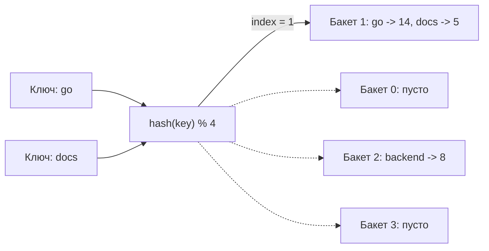

*Как хеш-таблица превращает строку `"backend"` в номер ячейки памяти за $O(1)$, почему возникают коллизии и зачем таблице нужно перехеширование.*

В Модуле 3 вы научились пользоваться мапами `map[string]int` и заметили удивительный факт: поиск ключа среди миллиона записей занимает почти столько же времени, сколько среди десяти — несколько десятков наносекунд. Но ведь компьютер умеет обращаться за $O(1)$ только к **числовому индексу массива** `buckets[i]`, а не к строке `"backend"`. Как мапа узнаёт, в какую именно ячейку смотреть, не перебирая ключи подряд?

Секрет прост и держится на трёх элементах: **хеш-функции**, **массиве бакетов** и **стратегии разрешения коллизий**.

## От ключа к номеру бакета: хеш-функция и коллизии

**Хеш-функция** (*hash function*) принимает ключ любого типа (строку, число, структуру) и детерминированно вычисляет из его байтов целое число фиксированной ширины — например, `uint64`. Одинаковые ключи всегда дают одинаковый хеш, а даже однобуквенное отличие (`"go"` и `"gp"`) даёт совершенно разные числа.

Затем хеш-таблица отображает это 64-битное число в индекс обычного массива **бакетов** (*buckets*, корзин) с помощью остатка от деления `index = hash % uint64(len(buckets))`:



Здесь сразу всплывает неизбежное явление — **коллизия** (*collision*). Возможных строк бесконечно много, а бакетов в массиве конечное число (скажем, 4 или 1 024). Значит, два разных ключа — например, `"go"` и `"docs"` — рано или поздно попадут в один и тот же индекс бакета.

Чтобы данные при этом не затирали друг друга, используют один из двух классических подходов:
1. **Метод цепочек (*separate chaining*):** каждый бакет хранит небольшой список (или слайс) всех пар `(key, value)`, попавших в этот индекс. При поиске таблица находит бакет за $O(1)$ и сравнивает ключи внутри него через `==`.
2. **Открытая адресация (*open addressing*):** все пары лежат прямо в одном плоском массиве без вложенных списков; если ячейка занята чужим ключом, алгоритм проверяет следующую свободную ячейку по заданному правилу.

## Коэффициент заполнения и перехеширование

Что произойдёт, если положить 10 000 тегов в таблицу из 4 бакетов? В каждом бакете накопится по ~2 500 записей, и поиск выродится из $O(1)$ в линейный перебор $O(n)$.

Чтобы бакеты оставались короткими (в среднем 1–2 записи), хеш-таблица отслеживает **коэффициент заполнения** (*load factor*):

$$\alpha = \frac{\text{число ключей}}{\text{число бакетов}}$$

Как только $\alpha$ превышает порог (обычно `0.75`), таблица выполняет **перехеширование** (*rehashing*): выделяет новый массив бакетов вдвое большего размера и заново раскладывает туда все существующие пары с новым остатком `hash % newSize`. Отдельное перехеширование стоит $O(n)$, но происходит всё реже по мере удвоения — поэтому вставка и поиск в среднем работают за **амортизированное $O(1)$** (а в худшем случае, при массовых коллизиях, деградируют до $O(n)$).

*Упрощение этого уровня:* наша учебная таблица ниже использует метод цепочек на слайсах, чтобы сделать механику полностью прозрачной. В реальных программах на Go всегда пользуйтесь встроенной `map` — её оптимизированная реализация в рантайме и защита от хеш-коллизий разбираются в Томе 5 («Под капотом»).

## Рабочий код: учебная хеш-таблица счётчика тегов

Соберём минимальную хеш-таблицу `TagCounter` с хеш-функцией FNV-1a из стандартного пакета `hash/fnv` и автоматическим ростом при $\alpha > 0.75$:

```go
package main

import (
	"fmt"
	"hash/fnv"
)

type entry struct {
	key   string
	value int
}

type TagCounter struct {
	buckets [][]entry
	size    int
}

func NewTagCounter(initialBuckets int) *TagCounter {
	if initialBuckets < 4 {
		initialBuckets = 4
	}
	return &TagCounter{buckets: make([][]entry, initialBuckets)}
}

func hashKey(key string) uint64 {
	h := fnv.New64a()
	_, _ = h.Write([]byte(key))
	return h.Sum64()
}

func (t *TagCounter) Put(key string, value int) {
	if float64(t.size+1)/float64(len(t.buckets)) > 0.75 {
		t.rehash(len(t.buckets) * 2)
	}
	idx := hashKey(key) % uint64(len(t.buckets))
	for i := range t.buckets[idx] {
		if t.buckets[idx][i].key == key {
			t.buckets[idx][i].value = value
			return
		}
	}
	t.buckets[idx] = append(t.buckets[idx], entry{key: key, value: value})
	t.size++
}

func (t *TagCounter) Get(key string) (int, bool) {
	idx := hashKey(key) % uint64(len(t.buckets))
	for _, e := range t.buckets[idx] {
		if e.key == key {
			return e.value, true
		}
	}
	return 0, false
}

func (t *TagCounter) rehash(newCap int) {
	old := t.buckets
	t.buckets = make([][]entry, newCap)
	t.size = 0
	for _, bucket := range old {
		for _, e := range bucket {
			t.Put(e.key, e.value)
		}
	}
}

func main() {
	tc := NewTagCounter(4)
	for _, tag := range []string{"go", "backend", "http", "linux", "docs"} {
		tc.Put(tag, len(tag))
	}
	v, ok := tc.Get("backend")
	fmt.Printf("backend=%d (found=%v), buckets=%d, size=%d\n", v, ok, len(tc.buckets), tc.size)
}
```

Запуск показывает, что после вставки пятого элемента таблица сама расширилась с 4 до 8 бакетов:

```text
$ go run main.go
backend=7 (found=true), buckets=8, size=5
```

Теперь становятся понятны два правила встроенной `map` в Go, которые в Модуле 3 приходилось просто запоминать. Во-первых, почему обход `for k := range m` идёт в непредсказуемом порядке: ключи разложены по бакетам согласно хешу (плюс Go намеренно сдвигает точку старта обхода). Во-вторых, почему ключ `map` обязан поддерживать сравнение `==`: после попадания в бакет таблица должна отличить искомый ключ от коллизии.

## Подводные камни

**Ловушка 1. Несравнимый тип в роли ключа `map`.**  
Попытка использовать слайс, мапу или функцию как ключ не пройдёт компиляцию:
```go
bad := make(map[[]string]int) // compile error: invalid map key type []string
```
Хеш-таблице нужно уметь сравнивать ключи внутри бакета через `==`, а слайсы в Go несравнимы. Вместо `[]string` ключом делают строку (например, склеенную через разделитель) или массив фиксированной длины `[3]string`.

**Ловушка 2. Игнорирование стартовой ёмкости `make(map[K]V, n)`.**  
Если вы заранее знаете, что загрузите 100 000 закладок в индекс, вызов `make(map[int]Bookmark)` без подсказки заставит таблицу многократно удваивать бакеты и пересчитывать позиции всех старых ключей. Передача `make(map[int]Bookmark, len(items))` экономит и время CPU, и память.

> [!check] Проверь понимание
> В нашей `TagCounter` изменили ключ на `"go"` с новым значением, когда `"go"` уже был в таблице. Почему в цикле `Put` перед `append` стоит проверка `if t.buckets[idx][i].key == key`?
>
> Без неё в бакете накопилось бы две записи с одинаковым ключом `"go"`, `t.size` стал бы неверным, а `Get("go")` всегда возвращал бы устаревшее первое значение.

## Практика

**Упражнение 1 (Базовое). Коллизия на ручном примере.**  
Пусть в таблице 5 бакетов (`len(buckets) == 5`), а упрощённая хеш-функция для целых ключей равна самому числу (`hash(k) = k`). В какие бакеты попадут ключи `12`, `7`, `25`, `17` и какие из них образуют коллизию?

> [!solution] Показать решение
> Считаем остатки от деления на 5:
> - `12 % 5 = 2`
> - `7 % 5 = 2`
> - `25 % 5 = 0`
> - `17 % 5 = 2`
>
> Ключи `12`, `7` и `17` попадут в **бакет 2** и образуют коллизию из трёх элементов; ключ `25` окажется в бакете `0`.

**Упражнение 2 (Практическое). Метод `Delete` для `TagCounter`.**  
Добавьте метод `func (t *TagCounter) Delete(key string) bool`, который удаляет запись по ключу из бакета, уменьшает `t.size` и возвращает `true`, если ключ был найден. Порядок элементов внутри одного бакета не важен.

> [!solution] Показать решение
> Поскольку порядок записей в бакете не важен, удаляем за $O(1)$ подменой последним элементом (как в проверке понимания из Урока 2):
> ```go
> func (t *TagCounter) Delete(key string) bool {
> 	idx := hashKey(key) % uint64(len(t.buckets))
> 	b := t.buckets[idx]
> 	for i, e := range b {
> 		if e.key == key {
> 			last := len(b) - 1
> 			b[i] = b[last]
> 			b[last] = entry{}
> 			t.buckets[idx] = b[:last]
> 			t.size--
> 			return true
> 		}
> 	}
> 	return false
> }
> ```
> Обнуление `b[last] = entry{}` освобождает ссылку на строку `key` для сборщика мусора.

**Упражнение 3 (Со звёздочкой \*). Чего хеш-таблица НЕ умеет.**  
Почему `map[int]Bookmark` не поможет быстро выполнить запрос «выдай все закладки с `ID` от `1000` до `1500` по возрастанию», и сколько шагов такой запрос потребует для $n$ закладок?

> [!solution] Показать решение
> Хеш-функция намеренно перемешивает соседние ключи (`1000` и `1001` попадают в совершенно разные бакеты). Чтобы найти все ключи в диапазоне `[1000, 1500]`, придётся либо обойти всю мапу за $O(n)$, либо проверить по отдельности каждый целый ключ диапазона (501 обращение), что бесполезно для строк или дробных чисел. Для запросов по диапазону и упорядоченного обхода нужны **отсортированные структуры** — отсортированные слайсы и деревья.

---

Хеш-таблица безупречна для точечного поиска по точному ключу за $O(1)$, но она стирает порядок элементов. Если данные уже отсортированы, мы получаем мощную альтернативу без накладных расходов на бакеты — **бинарный поиск**: [[5. Линейный и бинарный поиск — сила отсортированных данных]].
