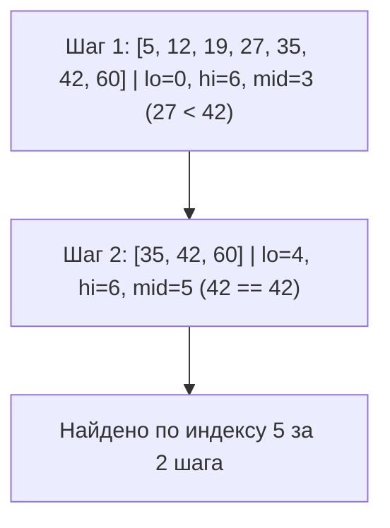

*Как упорядоченный слайс сокращает миллион проверок до двадцати шагов, как не ошибиться с границами цикла и чем удобен `slices.BinarySearch` в Go.*

Представьте, что `BookmarkFlow` держит в памяти отсортированный по `ID` каталог из **1 000 000** закладок. Пользователь просит найти запись с `ID = 742105` — или выбрать все закладки с `ID` от `700000` до `700100`. Заводить отдельную мапу ради такого поиска не хочется: она съест десятки мегабайт дополнительной RAM и всё равно не умеет отвечать на запросы по диапазону.

Обычный **линейный поиск** (*linear search*) проверяет элементы подряд с индекса `0` и в худшем случае делает $1\,000\,000$ сравнений — $O(n)$. Но раз слайс уже отсортирован по возрастанию, каждая проверка даёт гораздо больше информации, чем просто «совпало / не совпало».

## Сила деления пополам

Взглянем прямо в **середину** отсортированного слайса. Если средний элемент меньше искомого `target`, значит, вся левая половина гарантированно меньше `target` — её можно отбросить одним действием, даже не заглядывая внутрь. Если средний элемент больше `target`, отбрасываем всю правую половину.

На каждом шаге область поиска сжимается ровно **вдвое**. Посчитаем масштаб этой магии:
- $1\,000$ элементов → максимум $\lceil \log_2 1000 \rceil = \mathbf{10}$ проверок;
- $1\,000\,000$ элементов → максимум $\lceil \log_2 10^6 \rceil = \mathbf{20}$ проверок;
- $1\,000\,000\,000$ элементов → максимум $\mathbf{30}$ проверок.

Увеличили базу в тысячу раз — добавили всего 10 сравнений. Это и есть **логарифмическая сложность $O(\log n)$**. Проследим поиск `ID = 42` в отсортированном слайсе из 7 закладок:



## Инвариант границ и точка вставки

**Бинарный поиск** (*binary search*) кажется обманчиво простым, но на практике в нём ошибаются даже опытные разработчики — промахиваются на единицу в условии цикла или сдвиге границ. Чтобы писать его безошибочно, достаточно помнить один строгий **инвариант**: искомый элемент, если он вообще есть в слайсе, **всегда** лежит внутри отрезка `[lo, hi]` (включая обе границы).

Из этого инварианта автоматически следуют все четыре строки алгоритма:
1. Начинаем с `lo, hi := 0, len(sorted)-1`.
2. Пока отрезок не пуст (`lo <= hi`), берём середину `mid := lo + (hi-lo)/2`.
3. Если `sorted[mid] < target`, элемент не может лежать ни в `mid`, ни левее → ставим `lo = mid + 1`.
4. Если `sorted[mid] > target`, элемент не может лежать ни в `mid`, ни правее → ставим `hi = mid - 1`.

Обратите внимание на ещё одно полезное свойство: если цикл завершился без совпадения, индекс `lo` указывает ровно на **позицию, куда нужно вставить `target`**, чтобы слайс остался отсортированным. Стандартная функция `slices.BinarySearch` из Go использует ровно этот контракт: она возвращает `(pos, found)`, где `pos` — либо индекс найденного элемента, либо точное место для вставки (именно это мы применим в `TagIndex` шага 7).

## Рабочий код: ручной поиск и `slices.BinarySearchFunc`

Напишем ручную версию для `[]int` и покажем, как искать в слайсе структур `[]Bookmark` и выбирать диапазон через стандартный пакет `slices`:

```go
package main

import (
	"cmp"
	"fmt"
	"slices"
)

type Bookmark struct {
	ID    int
	Title string
}

// BinarySearchInt ищет target в отсортированном слайсе за O(log n).
// Возвращает индекс элемента (или точку вставки) и флаг found.
func BinarySearchInt(sorted []int, target int) (int, bool) {
	lo, hi := 0, len(sorted)-1
	for lo <= hi {
		mid := lo + (hi-lo)/2
		switch cmp.Compare(sorted[mid], target) {
		case 0:
			return mid, true
		case -1:
			lo = mid + 1
		case 1:
			hi = mid - 1
		}
	}
	return lo, false
}

func main() {
	ids := []int{5, 12, 19, 27, 35, 42, 60}
	pos, ok := BinarySearchInt(ids, 42)
	fmt.Printf("Поиск 42: pos=%d, found=%v\n", pos, ok)

	insPos, ok := BinarySearchInt(ids, 30)
	fmt.Printf("Поиск 30: insertPos=%d, found=%v\n", insPos, ok)

	catalog := []Bookmark{
		{ID: 10, Title: "Go Spec"},
		{ID: 25, Title: "Effective Go"},
		{ID: 40, Title: "Testing"},
		{ID: 55, Title: "Slices"},
	}

	// Поиск диапазона ID в [20, 45]: находим нижнюю границу за O(log n).
	start, _ := slices.BinarySearchFunc(catalog, 20, func(b Bookmark, target int) int {
		return cmp.Compare(b.ID, target)
	})
	for i := start; i < len(catalog) && catalog[i].ID <= 45; i++ {
		fmt.Printf("В диапазоне: %d (%s)\n", catalog[i].ID, catalog[i].Title)
	}
}
```

Запуск программы даёт точные индексы и мгновенную выборку по диапазону:

```text
$ go run main.go
Поиск 42: pos=5, found=true
Поиск 30: insertPos=4, found=false
В диапазоне: 25 (Effective Go)
В диапазоне: 40 (Testing)
```

В `slices.BinarySearchFunc` мы не создаём фиктивную структуру `Bookmark{ID: 20}`: функция принимает ключ `20` напрямую и сравнивает `b.ID` с `target`. Даже когда `ID = 20` отсутствует в каталоге, `start` указывает на первый элемент с `ID >= 20` (`ID = 25`), после чего остаётся пройти только нужный срез до `ID <= 45`.

## Подводные камни

**Ловушка 1. Бинарный поиск на неотсортированных данных молчит.**  
Ни `BinarySearchInt`, ни `slices.BinarySearch` не проверяют упорядоченность слайса — это стоило бы $O(n)$. На неотсортированных данных поиск без ошибки и паники вернёт `found = false` для существующего элемента.

**Ловушка 2. Переполнение `(lo + hi) / 2` и бесконечный цикл.**  
Формула `(lo + hi) / 2` в 32-битном `int` (или на гигантских индексах) способна переполниться и стать отрицательной. Всегда пишите **`lo + (hi-lo)/2`** — разность `hi - lo` не переполняется. Вторая частая ошибка — написать `lo = mid` вместо `lo = mid + 1`: при `lo == hi` цикл зависнет навсегда.

> [!check] Проверь понимание
> В отсортированном слайсе `[]int{10, 20, 20, 20, 30}` вызывается `slices.BinarySearch(s, 20)`. Гарантирует ли стандартная библиотека Go, что вернётся индекс **первого** вхождения `20` (индекс `1`), а не `2` или `3`?
>
> Да: по документации пакета `slices` `BinarySearch` всегда возвращает **наименьший индекс**, по которому лежит искомое значение (или куда его можно вставить). А вот наша ручная версия `BinarySearchInt` остановится на первом встречном `20` (индекс `2`), потому что сразу делает `return mid, true`.

## Практика

**Упражнение 1 (Базовое). Проследи границы (Code Tracing).**  
Проследите значения `(lo, hi, mid)` в `BinarySearchInt([]int{4, 9, 15, 22, 31}, 10)` на каждом шаге и назовите возвращаемую пару `(pos, found)`.

> [!solution] Показать решение
> 1. `lo=0, hi=4, mid=2` → `sorted[2] = 15 > 10` → `hi = 1`.
> 2. `lo=0, hi=1, mid=0` → `sorted[0] = 4 < 10` → `lo = 1`.
> 3. `lo=1, hi=1, mid=1` → `sorted[1] = 9 < 10` → `lo = 2`.
> 4. Теперь `lo = 2 > hi = 1` — цикл завершается и возвращает **`(2, false)`** (между `9` и `15`).

**Упражнение 2 (Практическое). Подсчёт вхождений в отсортированном слайсе за $O(\log n)$.**  
Напишите функцию `func countOccurrences(sorted []int, target int) int`, которая возвращает, сколько раз `target` встречается в отсортированном слайсе (с дубликатами), используя `slices.BinarySearch` за $O(\log n)$ (без линейного прохода по дубликатам).

> [!solution] Показать решение
> Находим индекс первого вхождения `target` и индекс первого элемента, который строго больше `target` (для целых чисел — это точка вставки `target + 1`, если не переполняет `math.MaxInt`, либо поиск через `slices.BinarySearchFunc`):
> ```go
> func countOccurrences(sorted []int, target int) int {
> 	left, found := slices.BinarySearch(sorted, target)
> 	if !found {
> 		return 0
> 	}
> 	// Ищем первый элемент строго больше target.
> 	right, _ := slices.BinarySearchFunc(sorted, target, func(elem, t int) int {
> 		if elem <= t {
> 			return -1
> 		}
> 		return 1
> 	})
> 	return right - left
> }
> ```
> Два бинарных поиска дают $2 \cdot O(\log n) = O(\log n)$, даже если в слайсе миллион одинаковых чисел.

**Упражнение 3 (Со звёздочкой \*). Когда линейный поиск выгоднее сортировки + бинарного поиска.**  
У вас есть **неотсортированный** слайс из $n = 100\,000$ закладок. Вы планируете найти в нём нужную закладку ровно 3 раза, после чего слайс больше не понадобится. Что быстрее: 3 линейных поиска или один раз отсортировать слайс и выполнить 3 бинарных поиска?

> [!solution] Показать решение
> **3 линейных поиска** окажутся значительно быстрее.
> - Три линейных поиска: $3 \cdot n \approx 300\,000$ операций.
> - Сортировка + 3 бинарных поиска: $O(n \log n) + 3 \cdot O(\log n) \approx 100\,000 \cdot 17 + 51 \approx 1\,700\,000$ операций (и ещё дороже по перемещениям в памяти).
>
> Сортировка окупается только тогда, когда число поисков велико (начиная примерно с $\log_2 n$ и выше) или когда данные изначально поддерживаются отсортированными.

---

Бинарный поиск творит чудеса на отсортированных данных, но откуда берётся сам порядок? В следующем уроке разберём, как сортировка за $O(n \log n)$ разгромно обгоняет наивные $O(n^2)$-алгоритмы и как правильно сортировать структуры в Go через `slices.SortFunc`: [[6. Сортировка — почему O(n log n) побеждает O(n^2) и как работает slices.SortFunc]].
