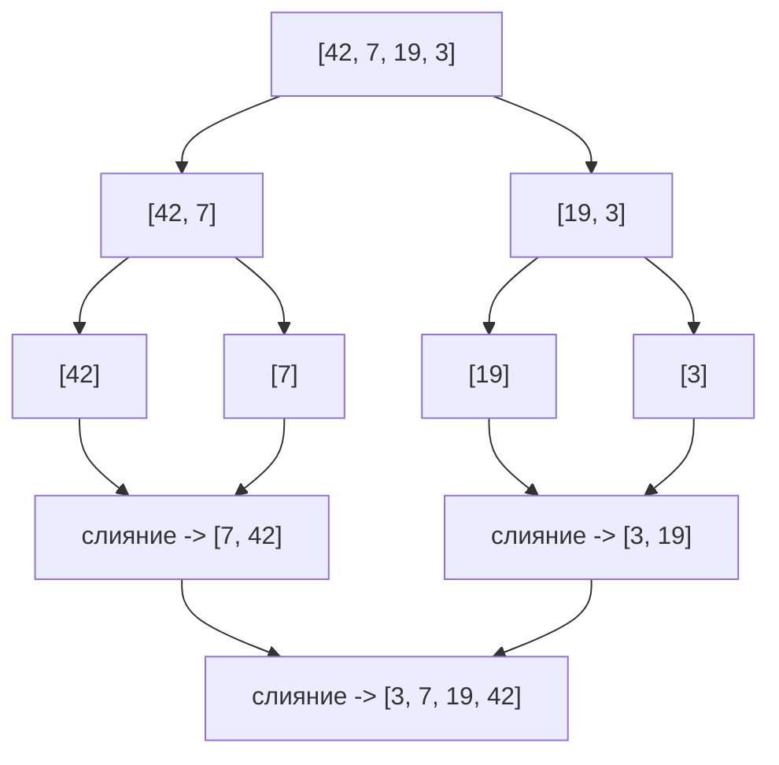

*Сравниваем квадратичную сортировку вставками с алгоритмом слияния $O(n \log n)$, разбираем устойчивость и осваиваем `slices.SortFunc` с `cmp.Or`.*

В предыдущем уроке мы убедились: отсортированный слайс открывает бинарный поиск за $O(\log n)$ и быстрые выборки по диапазонам. Но если отсортировать 100 000 закладок первым пришедшим в голову двойным циклом, компьютер выполнит порядка $5 \cdot 10^9$ сравнений и задумается на несколько секунд. Стандартная `slices.SortFunc` справится с тем же каталогом примерно за 15 миллисекунд — в сотни раз быстрее.

Почему между двумя способами упорядочить один и тот же слайс лежит такая пропасть? Ответ кроется в стратегии **«разделяй и властвуй»** (*divide and conquer*).

## $O(n^2)$ против $O(n \log n)$: вставки и слияние

Самый понятный квадратичный алгоритм — **сортировка вставками** (*insertion sort*). Вы берёте очередной элемент и сдвигаете его влево среди уже отсортированных соседей, пока он не встанет на своё место — точно так же люди раскладывают карты в руке.
- В худшем случае (массив перевёрнут наоборот) каждый из $n$ элементов сдвигается через всю левую часть → $O(n^2)$.
- Но у вставок есть важное достоинство: на **крошечных** слайсах (до ~16–24 элементов) и на **почти отсортированных** данных алгоритм почти не двигает память и работает за $O(n)$, обгоняя сложные схемы за счёт кэша L1.

Чтобы победить $O(n^2)$ на больших массивах, **сортировка слиянием** (*merge sort*) делит слайс пополам до кусочков длины 1 (один элемент уже отсортирован сам по себе), а затем **сливает** пары отсортированных половин в один упорядоченный слайс, двигая два указателя слева направо:



Посчитаем работу: делить слайс из $n$ элементов пополам можно ровно $\log_2 n$ раз (уровней дерева). На каждом уровне слияние проходит через все $n$ элементов ровно по одному разу. Перемножаем уровни на работу уровня — получаем гарантированные **$O(n \log n)$** в любом, даже самом неудобном случае. Цена за предсказуемость — $O(n)$ дополнительной памяти под буфер слияния.

## Что внутри `slices.SortFunc` и зачем нужна устойчивость

В стандартной библиотеке Go вам почти никогда не нужно писать сортировку руками. Пакет `slices` (доступный с Go 1.21) даёт три главные функции:
- `slices.Sort(s)` — для любых упорядочиваемых типов (`int`, `string`, `float64`);
- `slices.SortFunc(s, cmpFn)` — для структур и произвольных правил сравнения;
- `slices.SortStableFunc(s, cmpFn)` — **устойчивая** сортировка (*stable sort*).

Под капотом `slices.SortFunc` работает гибридный алгоритм **pdqsort** (*pattern-defeating quicksort*): он сочетает скорость быстрой сортировки на месте ($O(1)$ дополнительной памяти), вставки на коротких подмассивах и страховочный переход на пирамидальную сортировку, чтобы гарантировать $O(n \log n)$ даже на злонамеренных входах.

В чём разница между **неустойчивой** (`SortFunc`) и **устойчивой** (`SortStableFunc`) сортировкой? Представьте, что закладки уже отсортированы по дате добавления, а вы дополнительно сортируете их по категории (`"go"`, `"linux"`). **Устойчивая** сортировка гарантирует: две закладки с одинаковой категорией `"go"` сохранят свой прежний взаимный порядок (более ранняя останется раньше). Неустойчивая может поменять их местами, хотя обычно работает немного быстрее.

## Рабочий код: `MergeSort` и идиоматичная сортировка в Go 1.24

Сначала посмотрим на чистый `MergeSort` для слайса `[]int`, а затем — на сортировку структур `Bookmark` по двум полям с помощью `slices.SortFunc` и `cmp.Or`:

```go
package main

import (
	"cmp"
	"fmt"
	"slices"
	"strings"
)

func MergeSort(xs []int) []int {
	if len(xs) <= 1 {
		return xs
	}
	mid := len(xs) / 2
	left := MergeSort(xs[:mid])
	right := MergeSort(xs[mid:])
	return merge(left, right)
}

func merge(a, b []int) []int {
	out := make([]int, 0, len(a)+len(b))
	i, j := 0, 0
	for i < len(a) && j < len(b) {
		if a[i] <= b[j] { // <= сохраняет устойчивость сортировки
			out = append(out, a[i])
			i++
		} else {
			out = append(out, b[j])
			j++
		}
	}
	out = append(out, a[i:]...)
	out = append(out, b[j:]...)
	return out
}

type Bookmark struct {
	ID       int
	Priority int
	Title    string
}

func main() {
	fmt.Println("MergeSort:", MergeSort([]int{42, 7, 19, 3, 19}))

	items := []Bookmark{
		{ID: 3, Priority: 2, Title: "Testing"},
		{ID: 1, Priority: 1, Title: "Go Spec"},
		{ID: 2, Priority: 1, Title: "effective go"},
	}

	sorted := slices.Clone(items)
	slices.SortFunc(sorted, func(a, b Bookmark) int {
		return cmp.Or(
			cmp.Compare(a.Priority, b.Priority),
			cmp.Compare(strings.ToLower(a.Title), strings.ToLower(b.Title)),
			cmp.Compare(a.ID, b.ID),
		)
	})
	fmt.Println("Sorted:", sorted)
}
```

Вывод терминала:

```text
$ go run main.go
MergeSort: [3 7 19 19 42]
Sorted: [{2 1 effective go} {1 1 Go Spec} {3 2 Testing}]
```

Посмотрите, насколько выразительно связка `cmp.Or` + `cmp.Compare` (появившаяся в Go 1.22) решает многоуровневую сортировку: `cmp.Or` возвращает первый ненулевой результат из цепочки сравнений. Сначала сравнивается `Priority`; если приоритеты равны (`0`), в дело вступает `Title` без учёта регистра; при равных заголовках — `ID`.

## Подводные камни

**Ловушка 1. Сломанный компаратор в `slices.SortFunc`.**  
Функция сравнения обязана соблюдать строгий порядок: возвращать `0` при равенстве, отрицательное при `a < b` и положительное при `a > b`. Если написать `if a.ID < b.ID { return -1 }; return 1` (забыв вернуть `0` при `a.ID == b.ID`), сортировка может выдать мусор или вообще зациклиться на некоторых входах. Всегда используйте `cmp.Compare` вместо ручного вычитания `a.ID - b.ID` (вычитание к тому же переполняется на больших `int`).

**Ловушка 2. Мутация исходного слайса на месте.**  
`slices.SortFunc` переставляет элементы **прямо внутри переданного слайса** (изменяя его базовый массив). Если вызывающий код хранит оригинальный порядок (например, для бинарного поиска по `ID`), обязательно сделайте копию через `slices.Clone(items)` перед сортировкой по другому полю.

> [!check] Проверь понимание
> В функции `merge` выше стоит сравнение `if a[i] <= b[j]`. Что изменится, если заменить `<=` на строгое `<` при сортировке структур по ключу `Priority`?
>
> При равных ключах в результат первым попадёт элемент из **правой** половины `b`, и сортировка перестанет быть **устойчивой** (равные элементы поменяются местами).

## Практика

**Упражнение 1 (Базовое). Сортировка по убыванию.**  
Как с помощью `slices.SortFunc` и `cmp.Compare` отсортировать `[]Bookmark` по **убыванию** `Priority`, а при равном приоритете — по **возрастанию** `ID`?

> [!solution] Показать решение
> Чтобы перевернуть порядок на убывающий, достаточно поменять аргументы `a` и `b` в первом `cmp.Compare`:
> ```go
> slices.SortFunc(items, func(a, b Bookmark) int {
> 	return cmp.Or(
> 		cmp.Compare(b.Priority, a.Priority), // по убыванию Priority
> 		cmp.Compare(a.ID, b.ID),             // по возрастанию ID
> 	)
> })
> ```
> Сравнение `cmp.Compare(b, a)` безопаснее, чем `-cmp.Compare(a, b)`, и сразу ясно читается.

**Упражнение 2 (Практическое). Проверка отсортированности за $O(n)$.**  
Не вызывая пакет `slices`, напишите дженерик-функцию `func isSortedBy[T any](items []T, cmpFn func(a, b T) int) bool`, которая проверяет, упорядочен ли слайс по неубыванию, за $O(n)$ по времени и $O(1)$ по памяти.

> [!solution] Показать решение
> Достаточно проверить каждую соседнюю пару `(items[i-1], items[i])`:
> ```go
> func isSortedBy[T any](items []T, cmpFn func(a, b T) int) bool {
> 	for i := 1; i < len(items); i++ {
> 		if cmpFn(items[i-1], items[i]) > 0 {
> 			return false
> 		}
> 	}
> 	return true
> }
> ```
> Для пустого слайса и слайса из одного элемента цикл не выполнится и функция корректно вернёт `true`.

**Упражнение 3 (Со звёздочкой \*). Объясните выбор `slices.SortStableFunc`.**  
Каталог закладок пришёл уже отсортированным по дате создания (от новых к старым). Пользователь нажал «Сгруппировать по домену», но хочет, чтобы внутри каждого домена новые закладки по-прежнему шли выше старых. Почему `slices.SortFunc` по полю `Domain` здесь не подойдёт и какие два решения дадут правильный результат?

> [!solution] Показать решение
> `slices.SortFunc` неустойчива: две закладки с доменом `go.dev` могут произвольно поменяться местами, сломав исходный порядок по дате.
>
> Два верных решения:
> 1. Использовать **`slices.SortStableFunc`** только по `Domain` — устойчивая сортировка гарантированно сохранит исходный порядок по дате внутри каждого домена.
> 2. Использовать `slices.SortFunc` с составным компаратором `cmp.Or(cmp.Compare(a.Domain, b.Domain), cmp.Compare(b.CreatedAt, a.CreatedAt))`, явно задав вторичный ключ.

---

Посмотрите ещё раз на `MergeSort`: функция вызывала саму себя на половинках слайса, и всё выглядело удивительно чисто. Но как процессор и память Go справляются с функцией, которая вызывает саму себя десятки или тысячи раз? Разберём механику рекурсии и стека вызовов: [[7. Рекурсия и стек вызовов — ясность, базовый случай и лимит глубины]].
