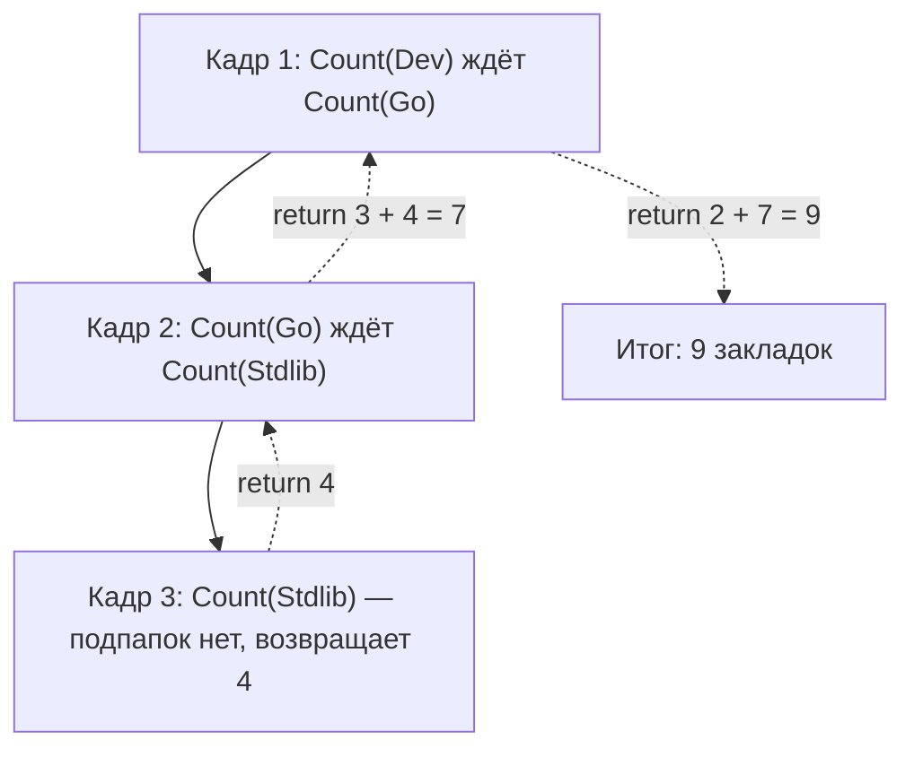

*Разбираем, как работает стек вызовов при рекурсии, почему забытый базовый случай роняет процесс без права на `recover` и когда цикл надёжнее рекурсии.*

> «Пишите ясно — не умничайте.»  
> — Брайан Керниган, *UNIX: A History and a Memoir*

В `MergeSort` функция вызывала саму себя на левой и правой половинах слайса. Теперь представьте папки с закладками в `BookmarkFlow`: корневая папка `"Dev"` хранит несколько закладок и вложенные подпапки `"Go"` и `"Linux"`, а внутри `"Go"` лежит ещё одна подпапка `"Stdlib"`. Вы заранее не знаете, какова глубина вложенности — 2 уровня или 15.

Как посчитать общее число закладок во всём дереве папок? Написать вложенные циклы `for` не выйдет — число циклов нужно знать на этапе компиляции. Зато правило задачи формулируется в одну строчку: *«число закладок в папке равно числу её собственных закладок плюс сумма закладок во всех её подпапках»*. Когда задача естественным образом выражается через уменьшенную копию самой себя, на сцену выходит **рекурсия** (*recursion*).

## Что происходит на стеке вызовов

Никакой магии в рекурсии нет — работает обычный **стек вызовов** (*call stack*) горутины, знакомый вам по Модулю 5 и Уроку 3 (дисциплина LIFO). При каждом вызове функции Go кладёт на вершину стека новый **кадр** (*stack frame*): её аргументы, локальные переменные и адрес возврата. Когда функция доходит до `return`, её кадр снимается со стека, и управление возвращается в точку вызова.

Проследим вызов `CountBookmarks` на дереве `Dev (2) -> Go (3) -> Stdlib (4)`:



Чтобы рекурсия завершилась, а не съела всю память, у неё обязаны быть две части:
1. **Базовый случай** (*base case*) — условие, при котором функция возвращает ответ сразу, без нового вызова себя (в `MergeSort` это `len(xs) <= 1`, в `CountBookmarks` — папка без подпапок).
2. **Шаг к базовому случаю** (*recursive step*) — каждый рекурсивный вызов обязан уменьшать размер задачи (половина слайса, дочерняя папка, `n - 1`), приближая остановку.

## Цена рекурсии и отличие от цикла

Вспомните цифру из Модуля 5: стек горутины в Go стартует с **2 КБ** и при необходимости автоматически растёт — вплоть до лимита (по умолчанию **1 ГБ** на 64-битных системах). Это огромный запас для деревьев высоты 30–50, но при бесконечной рекурсии или глубине в миллионы кадров стек всё равно переполняется.

Важная особенность Go: компилятор **не выполняет оптимизацию хвостовой рекурсии** (*tail-call optimization*). Даже если рекурсивный вызов стоит последней строкой функции, он всё равно создаёт новый кадр на стеке. Поэтому для плоского обхода слайса или списка всегда пишите обычный `for` — он тратит $O(1)$ памяти стека вместо $O(n)$.

## Рабочий код: рекурсивный и итеративный подсчёт папок

Напишем подсчёт закладок в дереве папок двумя способами — короткой рекурсией и явным циклом со стеком (чтобы увидеть, что любой рекурсивный обход переписывается на цикл):

```go
package main

import "fmt"

type Folder struct {
	Name      string
	Bookmarks int
	Children  []*Folder
}

// CountRecursive считает закладки рекурсивно: просто и ясно для деревьев.
func CountRecursive(f *Folder) int {
	if f == nil { // базовый случай
		return 0
	}
	total := f.Bookmarks
	for _, child := range f.Children {
		total += CountRecursive(child)
	}
	return total
}

// CountIterative делает то же самое через явный стек без риска переполнения стека вызовов.
func CountIterative(root *Folder) int {
	if root == nil {
		return 0
	}
	stack := []*Folder{root}
	total := 0
	for len(stack) > 0 {
		last := len(stack) - 1
		cur := stack[last]
		stack = stack[:last]
		total += cur.Bookmarks
		for _, child := range cur.Children {
			if child != nil {
				stack = append(stack, child)
			}
		}
	}
	return total
}

func main() {
	root := &Folder{
		Name:      "Dev",
		Bookmarks: 2,
		Children: []*Folder{
			{
				Name:      "Go",
				Bookmarks: 3,
				Children:  []*Folder{{Name: "Stdlib", Bookmarks: 4}},
			},
			{Name: "Linux", Bookmarks: 5},
		},
	}

	fmt.Println("Recursive:", CountRecursive(root))
	fmt.Println("Iterative:", CountIterative(root))
}
```

Вывод терминала:

```text
$ go run main.go
Recursive: 14
Iterative: 14
```

Рекурсивная версия занимает 9 строк и читается как определение самой задачи. Итеративная версия длиннее, но переносит хранение незавершённых папок со стека вызовов в обычный слайс в куче — если когда-нибудь придётся обойти вырожденную цепочку глубиной в миллион узлов, цикл справится спокойно.

## Подводные камни

**Ловушка 1. Переполнение стека нельзя поймать через `recover()`.**  
Если забыть базовый случай или ошибиться в условии выхода (`countdown(n)` без `if n <= 0`), горутина пробьёт лимит стека:
```text
runtime: goroutine stack exceeds 1000000000-byte limit
fatal error: stack overflow
```
Обратите внимание на префикс `fatal error` — это не обычная `panic`, её **нельзя перехватить** блоком `defer + recover`. Весь процесс немедленно падает.

**Ловушка 2. Экспоненциальный взрыв повторяющихся подзадач.**  
Классический пример — наивные числа Фибоначчи `fib(n) = fib(n-1) + fib(n-2)`. Функция раз за разом пересчитывает одни и те же `fib(5)`, `fib(4)`, `fib(3)`, и сложность взлетает до **$O(2^n)$**: `fib(45)` требует уже больше миллиарда вызовов и висит секундами, хотя цикл `for` считает `fib(45)` за 45 сложений (~30 нс).

> [!check] Проверь понимание
> На вход `CountRecursive` передали дерево глубиной 4 уровня, в котором всего 100 папок. Каково максимальное число одновременно открытых кадров `CountRecursive` на стеке вызовов — около 4 или около 100?
>
> **Около 4** (пропорционально **высоте** дерева, а не числу всех узлов). Как только обход одной ветки завершается, её кадры снимаются со стека и память переиспользуется для соседней ветки.

## Практика

**Упражнение 1 (Базовое). Найдите баг в базовом случае.**  
Почему вызов `sumRange(1, 5)` ниже работает, а `sumRange(5, 1)` мгновенно роняет программу с `stack overflow`? Исправьте условие.
```go
func sumRange(from, to int) int {
	if from == to {
		return from
	}
	return from + sumRange(from+1, to)
}
```

> [!solution] Показать решение
> При `from = 5, to = 1` шаг `from + 1` уводит `from` всё дальше от `to` (`5, 6, 7, ...`), поэтому равенство `from == to` не наступит никогда (до переполнения `int` и стека). Базовый случай должен отсекать весь пустой диапазон:
> ```go
> func sumRange(from, to int) int {
> 	if from > to {
> 		return 0
> 	}
> 	return from + sumRange(from+1, to)
> }
> ```
> А ещё лучше для линейного диапазона заменить рекурсию циклом `for` — или вообще формулой суммы прогрессии за $O(1)$.

**Упражнение 2 (Практическое). Максимальная глубина папок.**  
Напишите рекурсивную функцию `func MaxDepth(f *Folder) int`, которая возвращает максимальную глубину дерева папок (`0` для `nil`, `1` для папки без подпапок, `3` для примера `Dev -> Go -> Stdlib`).

> [!solution] Показать решение
> ```go
> func MaxDepth(f *Folder) int {
> 	if f == nil {
> 		return 0
> 	}
> 	best := 0
> 	for _, child := range f.Children {
> 		best = max(best, MaxDepth(child))
> 	}
> 	return 1 + best
> }
> ```
> Здесь удобно срабатывает встроенная функция `max` из Go 1.21+: для пустого `Children` цикл не выполняется и возвращается `1`.

**Упражнение 3 (Со звёздочкой \*). Спасите `fib(n)` от $O(2^n)$ за $O(n)$.**  
Перепишите вычисление $n$-го числа Фибоначчи (где `fib(0)=0`, `fib(1)=1`) итеративно за $O(n)$ по времени и $O(1)$ по памяти, чтобы `fib(50)` считалось за доли микросекунды.

> [!solution] Показать решение
> Достаточно хранить всего два последних значения вместо дерева рекурсивных вызовов:
> ```go
> func fib(n int) int {
> 	if n <= 1 {
> 		return n
> 	}
> 	prev, curr := 0, 1
> 	for i := 2; i <= n; i++ {
> 		prev, curr = curr, prev+curr
> 	}
> 	return curr
> }
> ```
> Сложность падает с экспоненциальной $O(2^n)$ до линейной $O(n)$ без единого лишнего кадра на стеке.

---

Мы только что применили рекурсию к иерархии папок. В информатике такая иерархия без циклов называется **деревом** — и если добавить к узлам простое правило упорядочивания, дерево объединит быстрый поиск, вставку и сортировку в одной структуре: [[8. Деревья и бинарное дерево поиска (BST)]].
