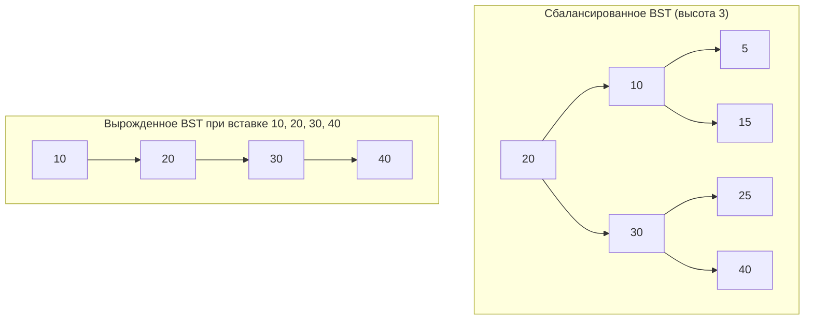

*Как бинарное дерево поиска совмещает быструю вставку, поиск за $O(\log n)$ и упорядоченный обход — и почему без балансировки оно способно выродиться в список.*

Посмотрите на дилемму, с которой мы столкнулись в прошлых уроках:
- **Отсортированный слайс** ищет элемент за $O(\log n)$ и легко выдаёт диапазоны (`ID` от 100 до 200), но вставка новой закладки в середину сдвигает половину массива — $O(n)$.
- **Хеш-таблица** вставляет и ищет за $O(1)$, но полностью ломает порядок ключей и бесполезна для диапазонов.

Можно ли одновременно быстро искать, быстро вставлять **и** сохранять порядок ключей? Именно эту тройную задачу решают **деревья поиска**.

## Устройство дерева и инвариант BST

**Дерево** (*tree*) — это иерархия узлов без циклов, растущая из одного верхнего узла — **корня** (*root*). Узлы без потомков называются **листьями** (*leaves*), а длина самого длинного пути от корня до листа — **высотой** (*height*, $h$) дерева.

Если у каждого узла не больше **двух** потомков (`Left` и `Right`), дерево называют **бинарным**. Добавим всего одно строгое правило — **инвариант бинарного дерева поиска** (*Binary Search Tree*, **BST**):
- все ключи в **левом** поддереве строго **меньше** ключа текущего узла;
- все ключи в **правом** поддереве строго **больше** ключа текущего узла.

Это правило работает рекурсивно для каждого узла. Поэтому поиск ключа в BST буквально повторяет бинарный поиск: сравниваем цель с текущим узлом и спускаемся либо налево, либо направо. Число шагов не превышает высоты дерева $h$.



Если дерево сбалансировано (левая и правая ветки примерно равны), его высота равна $h \approx \log_2 n$. Тогда и поиск, и вставка, и удаление работают за **$O(\log n)$** — без единого сдвига элементов в памяти. А рекурсивный обход в порядке **левое поддерево → текущий узел → правое поддерево** (*in-order traversal*) выдаёт все ключи строго по возрастанию за $O(n)$.

## Рабочий код: бинарное дерево поиска для закладок

Реализуем компактное BST с операциями `Insert`, `Search` и отсортированным обходом `InOrder`:

```go
package main

import "fmt"

type Node struct {
	ID    int
	Title string
	Left  *Node
	Right *Node
}

type BookmarkBST struct {
	root *Node
}

func (t *BookmarkBST) Insert(id int, title string) {
	t.root = insertNode(t.root, id, title)
}

func insertNode(n *Node, id int, title string) *Node {
	if n == nil {
		return &Node{ID: id, Title: title}
	}
	if id < n.ID {
		n.Left = insertNode(n.Left, id, title)
	} else if id > n.ID {
		n.Right = insertNode(n.Right, id, title)
	} else {
		n.Title = title // ключ уже есть — обновляем значение
	}
	return n
}

func (t *BookmarkBST) Search(id int) (string, bool) {
	cur := t.root
	for cur != nil {
		switch {
		case id < cur.ID:
			cur = cur.Left
		case id > cur.ID:
			cur = cur.Right
		default:
			return cur.Title, true
		}
	}
	return "", false
}

// InOrder обходит дерево слева направо, возвращая ID по возрастанию.
func (t *BookmarkBST) InOrder() []int {
	var out []int
	var walk func(*Node)
	walk = func(n *Node) {
		if n == nil {
			return
		}
		walk(n.Left)
		out = append(out, n.ID)
		walk(n.Right)
	}
	walk(t.root)
	return out
}

func main() {
	var tree BookmarkBST
	for _, b := range []struct {
		id    int
		title string
	}{
		{20, "Go Spec"},
		{10, "Testing"},
		{30, "Slices"},
		{15, "Maps"},
		{25, "Structs"},
	} {
		tree.Insert(b.id, b.title)
	}

	title, ok := tree.Search(15)
	fmt.Printf("Search(15): %q (found=%v)\n", title, ok)
	fmt.Println("InOrder:", tree.InOrder())
}
```

Вывод терминала:

```text
$ go run main.go
Search(15): "Maps" (found=true)
InOrder: [10 15 20 25 30]
```

Обратите внимание, что `Search` написан простым циклом `for cur != nil` за $O(1)$ памяти (без затрат на стек вызовов), а `insertNode` возвращает обновлённый указатель `*Node`, чтобы элегантно привязывать новый лист к родителю без дублирования проверок `if n.Left == nil`.

## Подводные камни

**Ловушка 1. Вырождение дерева в связный список на отсортированном вводе.**  
В реальных системах новые закладки и заказы почти всегда получают возрастающие идентификаторы `1, 2, 3, 4, ...`. Если вставить их в обычное BST подряд, каждый новый узел пойдёт строго в правую ветку `Right` (см. правую часть диаграммы выше). Высота дерева станет $h = n$, а поиск и вставка рухнут с $O(\log n)$ до **$O(n)$** — и рекурсивная вставка на миллионе ключей вдобавок переполнит стек.

Поэтому в промышленном коде обычное неуравновешенное BST не используют: вместо него применяют **самобалансирующиеся деревья** (AVL, красно-чёрные деревья — см. Том 6) и **B-деревья** (о которых пойдёт речь в следующем уроке).

**Ловушка 2. Иллюзия локальной проверки инварианта.**  
Узел `15` в правом поддереве узла `20` (под `30 -> Left`) нарушает инвариант BST, даже если `15 < 30`: оно меньше корня `20`, а значит, поиск `15` пойдёт налево от `20` и никогда его не найдёт. Инвариант касается **всего** поддерева, а не только непосредственного родителя.

> [!check] Проверь понимание
> Как найти **минимальный** ключ в непустом бинарном дереве поиска без полного обхода всех узлов, и какова сложность этой операции для дерева высоты $h$?
>
> Спускаться от корня строго влево (`for cur.Left != nil { cur = cur.Left }`) до узла без левого потомка. Сложность — **$O(h)$** (то есть $O(\log n)$ в сбалансированном дереве).

## Практика

**Упражнение 1 (Базовое). Проследи порядок обхода (Code Tracing).**  
В пустое `BookmarkBST` по очереди вставили ключи `12`, `6`, `18`, `3`, `9`, `15`. Какие ключи окажутся листьями (узлами без потомков) и какой слайс вернёт `InOrder()`?

> [!solution] Показать решение
> Корень — `12`; слева `6` с детьми `3` и `9`; справа `18` с левым ребёнком `15`.
> Листья: **`3`, `9`, `15`**.
> `InOrder()` всегда выдаёт ключи строго по возрастанию: **`[3 6 9 12 15 18]`**.

**Упражнение 2 (Практическое). Поиск диапазона ключей `[low, high]` в BST.**  
Напишите метод `func (t *BookmarkBST) Range(low, high int) []int`, который возвращает все `ID` в отрезке `[low, high]` по возрастанию, **не заходя** в заведомо лишние поддеревья.

> [!solution] Показать решение
> Опираемся на инвариант BST: идём налево только если `n.ID > low`, а направо — только если `n.ID < high`:
> ```go
> func (t *BookmarkBST) Range(low, high int) []int {
> 	var out []int
> 	var walk func(*Node)
> 	walk = func(n *Node) {
> 		if n == nil {
> 			return
> 		}
> 		if n.ID > low {
> 			walk(n.Left)
> 		}
> 		if n.ID >= low && n.ID <= high {
> 			out = append(out, n.ID)
> 		}
> 		if n.ID < high {
> 			walk(n.Right)
> 		}
> 	}
> 	walk(t.root)
> 	return out
> }
> ```
> Такая обрезка веток работает за $O(h + k)$, где $k$ — число найденных ключей в диапазоне.

**Упражнение 3 (Со звёздочкой \*). Проверка корректности BST.**  
Напишите функцию `func isValidBST(root *Node) bool`, которая проверяет, соблюдается ли глобальный инвариант BST для всего дерева (ловя подвох из Ловушки 2).

> [!solution] Показать решение
> Протаскиваем допустимый интервал `(minKey, maxKey)` сверху вниз при рекурсивном спуске (используя указатели `*int`, чтобы не привязываться к `math.MinInt`/`math.MaxInt`):
> ```go
> func isValidBST(root *Node) bool {
> 	var check func(n *Node, lo, hi *int) bool
> 	check = func(n *Node, lo, hi *int) bool {
> 		if n == nil {
> 			return true
> 		}
> 		if lo != nil && n.ID <= *lo {
> 			return false
> 		}
> 		if hi != nil && n.ID >= *hi {
> 			return false
> 		}
> 		return check(n.Left, lo, &n.ID) && check(n.Right, &n.ID, hi)
> 	}
> 	return check(root, nil, nil)
> }
> ```
> Каждый узел посещается ровно один раз — $O(n)$ по времени и $O(h)$ по стеку.

---

Бинарное дерево поиска отлично чувствует себя в оперативной памяти (если его балансировать), но стоит перенести индекс на диск — и у двоичного дерева возникает серьёзная проблема с физикой чтения страниц. Как эту проблему решили создатели движков баз данных, разберём прямо сейчас: [[9. Идея B-Tree — как деревья работают со страницами диска (мостик к Тому 2)]].
