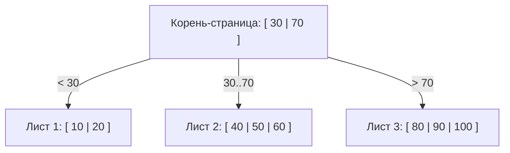

*Почему двоичные деревья проигрывают при хранении на диске, как `B-Tree` ужимает 16 миллионов ключей в три чтения страницы и как эта идея открывает дорогу к Тому 2.*

Допустим, наш каталог закладок перерос оперативную память — в нём 16 миллионов записей, и индекс теперь лежит на диске. Сбалансированное бинарное дерево поиска из предыдущего урока для $16\,777\,216$ ключей имеет высоту $\log_2(16\,777\,216) = \mathbf{24}$ уровня.

В оперативной памяти 24 прыжка по указателям стоят примерно $24 \times 100\text{ нс} \approx 2.4\text{ мкс}$. На NVMe SSD одно случайное чтение занимает около **100 мкс** — в тысячу раз дольше обращения к RAM. Но главное даже не это: операционная система и накопитель **не умеют** читать с диска 16 байт одного узла BST. Они всегда считывают целую **страницу** размером **4 КБ** (а многие движки баз данных работают со страницами по 8 КБ или 16 КБ).

Если положить в 4-килобайтную страницу один 24-байтный узел BST, 99% прочитанных байтов пропадут впустую, а поиск потребует 24 чтения с диска — больше 2 миллисекунд на запрос.

## Один узел = одна страница диска: рождение `B-Tree`

В 1970 году Рудольф Байер и Эдвард МакКрейт в исследовательской лаборатории Boeing предложили изящный выход, который и сегодня лежит в фундаменте почти всех промышленных хранилищ — **B-дерево** (**`B-Tree`**).

Идея переворачивает бинарное дерево с ног на голову: **зачем хранить в узле 1 ключ и 2 ссылки, если вся страница 4 КБ всё равно уже прочитана с диска?** Упакуем в один узел сразу **сотни** отсортированных ключей и ссылок на дочерние страницы.

Посчитаем эффект на конкретных цифрах. Пусть одна страница 4 КБ вмещает всего **256** ключей и ссылок (фактор ветвления $B = 256$):
- **Уровень 1 (корень):** 1 страница → до $256$ направлений;
- **Уровень 2:** $256$ страниц → до $256^2 = 65\,536$ направлений;
- **Уровень 3 (листья):** $65\,536$ страниц → до $256^3 = \mathbf{16\,777\,216}$ ключей.

Вместо 24 обращений к диску поиск среди 16 миллионов записей делает максимум **3 чтения страницы** (а верхние уровни почти всегда уже в кэше RAM, так что до диска доходит 1 чтение). Внутри прочитанной страницы бинарный поиск по 256 ключам в L1-кэше занимает считанные наносекунды.

Миниатюрное `B-Tree` с максимум двумя ключами и тремя детьми на страницу:



## Самобалансировка снизу вверх и шаг к B+ Tree

В отличие от обычного BST, `B-Tree` **всегда идеально сбалансировано**: все его листья лежат на одинаковой глубине. Когда страница-лист переполняется, она **делится пополам** (*node split*), а средний ключ поднимается в родительский узел. Если переполняется корень, дерево растёт **вверх**, добавляя ровно 1 уровень одновременно всем веткам.

В современных движках баз данных обычно используют модификацию **B+ Tree**:
1. Внутренние страницы хранят **только ключи-разделители и ссылки на детей** — фактор ветвления выше, а дерево ещё ниже.
2. Сами записи лежат **в листьях**, соединённых в цепочку: для выборки диапазона `1000..5000` движок спускается к `1000` за 3 шага и затем читает соседние листья подряд без возврата к корню.

*Мостик к Тому 2:* страничные форматы, блокировки и индексы промышленных хранилищ детально разбираются в **Томе 2 («Базы данных»)** — теперь слово «индекс» перестанет быть для вас магией.

## Рабочий код: поиск в многоключевом узле-странице на Go

Смоделируем в памяти одно важное свойство `B-Tree` — поиск по дереву, где каждый узел хранит отсортированный слайс ключей и использует `slices.BinarySearch` внутри страницы:

```go
package main

import (
	"fmt"
	"slices"
)

// BNode моделирует одну «страницу» B-Tree с несколькими отсортированными ключами.
type BNode struct {
	Keys     []int    // отсортированы по возрастанию
	Children []*BNode // len(Children) == 0 у листа, либо len(Keys)+1 у внутреннего узла
}

// Search спускается по страницам, выполняя бинарный поиск внутри каждой страницы.
func (n *BNode) Search(target int) (found bool, hops int) {
	cur := n
	for cur != nil {
		hops++
		pos, ok := slices.BinarySearch(cur.Keys, target)
		if ok {
			return true, hops
		}
		if len(cur.Children) == 0 {
			return false, hops // дошли до листа, ключа нет
		}
		cur = cur.Children[pos] // pos указывает точно на нужную дочернюю ветку
	}
	return false, hops
}

func main() {
	root := &BNode{
		Keys: []int{30, 70},
		Children: []*BNode{
			{Keys: []int{10, 20}},
			{Keys: []int{40, 50, 60}},
			{Keys: []int{80, 90, 100}},
		},
	}

	for _, key := range []int{50, 70, 65} {
		found, hops := root.Search(key)
		fmt.Printf("Поиск %d: found=%v, прочитано страниц=%d\n", key, found, hops)
	}
}
```

Вывод терминала:

```text
$ go run main.go
Поиск 50: found=true, прочитано страниц=2
Поиск 70: found=true, прочитано страниц=1
Поиск 65: found=false, прочитано страниц=2
```

Обратите внимание, как красиво состыковался контракт `slices.BinarySearch` из Урока 5 со структурой `BNode`: когда ключ `50` не найден в корне `[30, 70]`, `slices.BinarySearch` возвращает точку вставки `pos = 1` — и это **ровно индекс дочерней страницы** `cur.Children[1]` (`[40, 50, 60]`), в которой лежит диапазон `(30, 70)`. Для `65` он тоже спускается в `Children[1]`, проверяет лист и за 2 шага уверенно отвечает `false`.

## Подводные камни

**Ловушка 1. Страх, что «256 ключей в одном узле замедлят поиск».**  
Новичкам иногда кажется, что искать среди 256 ключей в одном узле долго по сравнению с одним ключом в BST. Но сравните задержки: 8 сравнений бинарного поиска в L1-кэше занимают **~15 наносекунд**, а одно лишнее чтение страницы с SSD — **~100 000 наносекунд** (в 6 000 раз дороже). Снизить высоту дерева с 24 до 3 — колоссальный выигрыш.

**Ловушка 2. Путаница между `B-Tree` и бинарным деревом (`Binary Tree`).**  
Буква **B** в `B-Tree` **не означает** *Binary* (двоичное): узлы содержат десятки и сотни потомков (исторически «B» чаще связывают со *Balanced* или *Boeing*).

> [!check] Проверь понимание
> Узел `B-Tree` хранит ключи `[15, 40, 85]` и имеет 4 дочерние страницы `Children[0..3]`. В какую дочернюю страницу спустится `Search(41)` и в какую — `Search(10)`?
>
> Для `41` `slices.BinarySearch` вернёт `pos = 2` (между `40` и `85`) → **`Children[2]`**. Для `10` вернётся `pos = 0` (меньше `15`) → **`Children[0]`**.

## Практика

**Упражнение 1 (Базовое). Оцените высоту `B-Tree` на реальных числах.**  
Каждая страница `B-Tree` вмещает 100 ссылок на дочерние страницы. Каково максимальное число листьев на глубине 4 (1 корень + 3 перехода вниз) и сколько переходов потребовало бы сбалансированное BST для того же объёма данных?

> [!solution] Показать решение
> - В `B-Tree` на глубине 4 помещается до $100^3 = 1\,000\,000$ листьев (а если каждый лист хранит ~100 записей — до **100 миллионов записей** всего за 4 чтения страниц).
> - Сбалансированному BST для 100 миллионов записей понадобилось бы $\lceil \log_2(10^8) \rceil = \mathbf{27}$ переходов по указателям.

**Упражнение 2 (Практическое). Сбор всех ключей `BNode` по возрастанию.**  
Напишите метод `func (n *BNode) InOrder() []int` для нашего `BNode`, который рекурсивно возвращает все ключи дерева в порядке возрастания (для примера из `main()` результат должен быть `[10 20 30 40 50 60 70 80 90 100]`).

> [!solution] Показать решение
> Ключи чередуются с дочерними страницами: перед `Keys[i]` обходим `Children[i]`, а после последнего ключа — хвост `Children[len(Keys)]`:
> ```go
> func (n *BNode) InOrder() []int {
> 	if n == nil {
> 		return nil
> 	}
> 	var out []int
> 	for i, k := range n.Keys {
> 		if i < len(n.Children) {
> 			out = append(out, n.Children[i].InOrder()...)
> 		}
> 		out = append(out, k)
> 	}
> 	if len(n.Children) > len(n.Keys) {
> 		out = append(out, n.Children[len(n.Keys)].InOrder()...)
> 	}
> 	return out
> }
> ```
> Для листа (`len(n.Children) == 0`) обе проверки `if` пропускаются, и цикл просто копирует `n.Keys`.

**Упражнение 3 (Со звёздочкой \*). Почему `B+ Tree` побеждает `B-Tree` на диапазонах.**  
В базе нужно прочитать все закладки за последний месяц (50 000 записей подряд по дате). Объясните в 2–3 предложениях, почему `B+ Tree` выполнит эту задачу быстрее, чем классическое `B-Tree`, где данные лежат в том числе во внутренних узлах.

> [!solution] Показать решение
> В классическом `B-Tree` при обходе диапазона движку приходится постоянно «прыгать вверх-вниз» между внутренними страницами и листьями, а сами внутренние страницы вмещают меньше ключей из-за хранения данных. В `B+ Tree` все записи лежат на нижнем уровне листьев, соединённых прямыми ссылками друг на друга: движок один раз находит начало месяца за 3–4 шага, а затем последовательно читает соседние листья слева направо без единого возврата к корню.

---

Деревья идеально описывают строгие иерархии и отсортированные индексы, но они запрещают циклы и «перекрёстные» связи. Что делать, если веб-страница A ссылается на страницу B, B — на C, а C — обратно на A? Для произвольных сетей связей нужна самая общая структура данных — **граф**: [[10. Графы на пальцах — списки смежности, BFS и DFS]].
