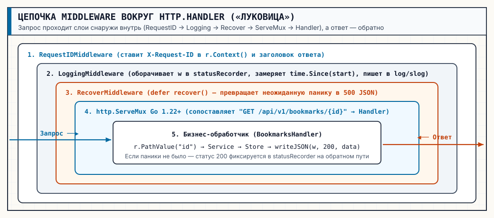

*Разбираем паттерн `Middleware` в `net/http`, сборку цепочки через функцию `Chain` и порядок вложенности обёрток вокруг `http.ServeMux`.*

Допустим, в вашем сервисе уже семь маршрутов, и к каждому нужно добавить три сквозные задачи: присвоить запросу идентификатор, замерить время выполнения и не дать случайной панике обрушить весь процесс. Если скопировать этот код в начало и конец `handleList`, `handleCreate`, `handleGet`, `handleUpdate` и остальных обработчиков, то при каждом изменении формата лога придётся править десяток функций — и рано или поздно про одну из них забудут.

В Go эту задачу решает простой функциональный паттерн без единого интерфейса или рефлексии — **промежуточный обработчик (`Middleware`)**.

## Функция, которая принимает и возвращает `http.Handler`

В `project/final/middleware.go` паттерн задан одной строкой:

```go
// Middleware — стандартная обёртка вокруг http.Handler.
type Middleware func(http.Handler) http.Handler
```

Идея до предела прозрачна. Обычный `http.Handler` умеет принять `(w, r)` и отдать ответ. Middleware берёт исходный обработчик `next` и возвращает **новый** `http.Handler` (обычно через `http.HandlerFunc`), который может:

1. Выполнить работу **до** вызова `next.ServeHTTP(w, r)` (добавить заголовок, проверить права, положить значение в контекст или отклонить запрос сразу, не вызывая `next`).
2. Передать управление внутрь `next.ServeHTTP(w, r)`.
3. Выполнить работу **после** возврата из `next` (записать итоговый статус и длительность в лог, поймать панику в `defer`).

Поскольку снаружи обёртка остаётся тем же интерфейсом `http.Handler`, их можно надевать друг на друга как матрёшки — и передавать получившийся результат в `http.Server` или в `httptest`.

## Сборка цепочки в `Chain`

Если нанизывать три обёртки напрямую в коде, вызов быстро становится трудночитаемым: `m1(m2(m3(mux)))`. Гораздо нагляднее перечислить слои сверху вниз, в том порядке, в котором в них входит запрос. В `project/final/server.go` сборка выглядит так:

```go
	s.handler = Chain(
		mux,
		RequestIDMiddleware(),
		LoggingMiddleware(logger),
		RecoverMiddleware(logger),
	)
```

Чтобы первый переданный в `Chain` элемент (`RequestIDMiddleware`) стал **самым внешним** слоем, цикл внутри `Chain` должен заворачивать `h` в **обратном** порядке — с конца списка к началу:

```go
// Chain применяет middleware слева направо (первый в списке оборачивает внешним слоем).
func Chain(h http.Handler, mws ...Middleware) http.Handler {
	for i := len(mws) - 1; i >= 0; i-- {
		h = mws[i](h)
	}
	return h
}
```

Развернём в уме этот цикл для трёх слоёв (`mws = [RequestID, Logging, Recover]`):

1. `i = 2`: `h = Recover(mux)`
2. `i = 1`: `h = Logging(Recover(mux))`
3. `i = 0`: `h = RequestID(Logging(Recover(mux)))`



Вот какой путь пройдёт каждый входящий HTTP-запрос:

```text
Запрос ──▶ RequestID (ставит X-Request-ID и кладёт в r.Context)
             │
             ▼
           Logging (засекает start := time.Now())
             │
             ▼
           Recover (ставит defer recover())
             │
             ▼
           ServeMux ──▶ handleCreate / handleGet / ...
             │
             ▼
           Recover (выходит без паники — или ловит панику и пишет 500)
             │
             ▼
           Logging (пишет метод, путь, статус и duration_ms)
             │
             ▼
Ответ ◀─── RequestID
```

## Почему порядок слоёв критичен

Не каждый порядок в `Chain` работает одинаково. Попробуйте мысленно поменять две строки местами — и сразу увидите последствия:

- **Что будет, если поставить `LoggingMiddleware` раньше `RequestIDMiddleware`?** На входе в логер контекст `r.Context()` ещё **не содержит** идентификатора запроса, поэтому в лог уйдёт пустой `"request_id":""`.
- **Что будет, если поставить `RecoverMiddleware` раньше `LoggingMiddleware`?** Если обработчик запаникует, паника проскочит сквозь `LoggingMiddleware` по стеку вверх к внешнему `RecoverMiddleware`, и строка после `next.ServeHTTP` в логере никогда не выполнится — запрос пропадёт из лога доступа. В нашем порядке `Recover` сидит внутри `Logging`: он превращает панику в статус `500` и спокойно возвращает управление `Logging`, который фиксирует сбойный статус `500` в общем журнале запросов.

## Живой пример: простая обёртка заголовка

Проверим работу `Chain` на коротком самостоятельном примере, печатающем порядок входа и выхода слоёв в терминал:

```go
package main

import (
	"fmt"
	"net/http"
	"net/http/httptest"
)

type Middleware func(http.Handler) http.Handler

func Chain(h http.Handler, mws ...Middleware) http.Handler {
	for i := len(mws) - 1; i >= 0; i-- {
		h = mws[i](h)
	}
	return h
}

func trace(name string) Middleware {
	return func(next http.Handler) http.Handler {
		return http.HandlerFunc(func(w http.ResponseWriter, r *http.Request) {
			fmt.Println("вход:", name)
			next.ServeHTTP(w, r)
			fmt.Println("выход:", name)
		})
	}
}

func main() {
	core := http.HandlerFunc(func(w http.ResponseWriter, _ *http.Request) {
		fmt.Println("ядро: обработка запроса")
		fmt.Fprintln(w, "ok")
	})

	wrapped := Chain(core, trace("1-внешний"), trace("2-внутренний"))
	wrapped.ServeHTTP(httptest.NewRecorder(), httptest.NewRequest(http.MethodGet, "/", nil))
}
```

Вывод терминала наглядно подтверждает модель «луковицы»:

```text
вход: 1-внешний
вход: 2-внутренний
ядро: обработка запроса
выход: 2-внутренний
выход: 1-внешний
```

> [!check] Проверь понимание
> Что выведет программа выше, если переписать цикл в `Chain` в прямом порядке (`for i := 0; i < len(mws); i++`)?
>
> Первым внешним слоем станет последний элемент списка: программа напечатает `вход: 2-внутренний`, затем `вход: 1-внешний`, ядро, `выход: 1-внешний`, `выход: 2-внутренний`.

## Практика

**Упражнение 1 (Базовое). Короткое замыкание в middleware.**  
Допустим, вы пишете простейшую проверку токена `AuthMiddleware(secret string)`: если заголовок `r.Header.Get("X-API-Key") != secret`, middleware должен вернуть статус `401 Unauthorized` и **не передавать** управление дальше в `next`. Какие две ошибки совершают чаще всего при реализации такого раннего выхода?

> [!solution] Показать решение
> Чаще всего забывают поставить `return` после записи ошибки (и тогда следом вызывается `next.ServeHTTP`, ломая ответ) или случайно вызывают `next.ServeHTTP` до проверки. Верный вариант:
> ```go
> func AuthMiddleware(secret string) Middleware {
> 	return func(next http.Handler) http.Handler {
> 		return http.HandlerFunc(func(w http.ResponseWriter, r *http.Request) {
> 			if r.Header.Get("X-API-Key") != secret {
> 				http.Error(w, "unauthorized", http.StatusUnauthorized)
> 				return
> 			}
> 			next.ServeHTTP(w, r)
> 		})
> 	}
> }
> ```

**Упражнение 2 (Практическое). Добавление времени ответа в заголовок.**  
Напишите middleware `ServerVersionMiddleware(version string)`, которое ставит заголовок `X-Server-Version: <version>` для всех маршрутов. В какое место `Chain` в `BookmarkFlow` его разумно поставить?

> [!solution] Показать решение
> ```go
> func ServerVersionMiddleware(version string) Middleware {
> 	return func(next http.Handler) http.Handler {
> 		return http.HandlerFunc(func(w http.ResponseWriter, r *http.Request) {
> 			w.Header().Set("X-Server-Version", version)
> 			next.ServeHTTP(w, r)
> 		})
> 	}
> }
> ```
> Ставить заголовок нужно **до** вызова `next.ServeHTTP(w, r)` (иначе внутренний обработчик уже вызовет `WriteHeader`, и заголовок потеряется). В `Chain` его удобно поставить сразу после `RequestIDMiddleware`, чтобы заголовок присутствовал даже на ответах `500` из `RecoverMiddleware`.

**Упражнение 3 (Со звёздочкой \*). Middleware с параметром и паника при старте.**  
Посмотрите на `Chain(nil, RequestIDMiddleware())` — что случится при первом входящем запросе? Как защитить `Chain` от случайной передачи `nil` в качестве `h` или одного из элементов `mws`?

> [!solution] Показать решение
> Если передать `h == nil`, `RequestIDMiddleware` без паники вернёт обёртку, но на первом же HTTP-запросе вызов `next.ServeHTTP(w, r)` упадёт с паникой разыменования `nil`-интерфейса! А при `nil` внутри `mws` паника случится сразу в `Chain` при вызове `mws[i](h)`. Безопасный вариант `Chain` сразу проверяет инварианты на старте:
> ```go
> func Chain(h http.Handler, mws ...Middleware) http.Handler {
> 	if h == nil {
> 		panic("Chain: handler must not be nil")
> 	}
> 	for i := len(mws) - 1; i >= 0; i-- {
> 		if mws[i] == nil {
> 			continue
> 		}
> 		h = mws[i](h)
> 	}
> 	return h
> }
> ```

---

Механика сборки цепочки `Chain` понятна. В следующем уроке разберём три конкретных боевых middleware из `project/final/middleware.go` — генерацию `Request-ID`, перехват статуса ответа для `log/slog` и спасение процесса при панике.
